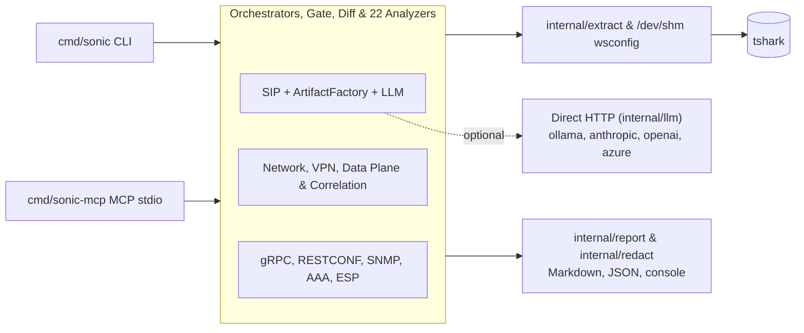

# S.O.N.I.C. - SIP Observation and Network Inspection Console

[](https://github.com/zombat/sonic/actions/workflows/ci.yml)
[](https://go.dev/dl/)
[](https://opensource.org/licenses/MIT)

**S.O.N.I.C. (SIP Observation and Network Inspection Console)** is a dependency-free Go packet capture inspection engine and 21-tool MCP server (`sonic` and `sonic-mcp`). Originally built for AI-assisted VoIP/SIP/RTP call quality and MOS troubleshooting, it provides deterministic (`No LLM`) inspection of IPsec/IKE/GRE/DMVPN Phase 3 overlays, BGP/OSPF/EIGRP routing and convergence, TCP/TLS/PMTUD/QoS data planes (including a pure-Go `go-fast` L2-L4 path), gRPC/gNMI/gNOI, zero-cleartext audits, CI policy gates (`sonic gate`), baseline diffing (`sonic diff`), multi-capture correlation, and key-backed decryption (`RESTCONF`, `SNMPv3`, `TACACS+/RADIUS`, `ESP`), alongside offline HTML reports, an ANSI TUI, and optional local or cloud LLM VoIP diagnostics. (Anyone needing the retired Python runtime or pure-Python `scapy` fallback can use the pinned `v3.3.0` release tag.)

### Quick Navigation
- [Prerequisites & Go Build](#-prerequisites)
- [Quick Start (CLI Examples)](#-quick-start)
- [Network and VPN Detectors](#-network-and-vpn-detectors)
- [gRPC Troubleshooting](#-grpc-troubleshooting-gnmi-gnoi-any-grpc-service)
- [Decryption with Your Own Keys](#-decryption-with-your-own-keys)
- [Multi-Provider LLM Support & API Keys](#-multi-provider-llm-support)
- [MCP Integration (21 Tools)](#-mcp-integration)
- [Troubleshooting](#-troubleshooting)
- [Go vs Python Performance](#-go-vs-python-performance) ([benchmark.md](benchmark.md))
- [Testing & Development Setup](#-testing)

## 📖 Background: From Manual to AI-Powered

**S.O.N.I.C. started as a personal tool to automate what I was already doing by hand.**

As a VoIP engineer, I spent years manually analyzing packet captures: importing pcaps into Wireshark, drilling through SIP dialogs, correlating RTP streams, checking codec payloads, inspecting authentication headers, and writing detailed findings. It was repetitive, thorough, but time-consuming.

What began in 2019 as a simple shell script to automate my manual troubleshooting grew into a sophisticated, multi-stage evolution of my personal workflow. By 2023, I had migrated that logic into Python, codifying every heuristic and analysis step I’d perfected over the years. While this version was excellent at systematic detection, it hit a ceiling: it could identify what was wrong, but it lacked the human-like nuance to explain why.

To bridge that gap, I launched a 2025 weekend project integrating Claude (LLM) to analyze the structured data. Instead of me manually interpreting the results, the AI began processing SIP flows, RTP metrics, and codec negotiations to generate natural-language diagnostics. That successful weekend proof-of-concept quickly scaled through Phase 2 and Phase 3, transforming a personal script into a full-scale production tool.

**Today, S.O.N.I.C. provides:**
- Native dependency-free Go CLI (`sonic`) and MCP stdio server (`sonic-mcp`) binaries built with `CGO_ENABLED=0` for Linux, macOS, and Windows (direct HTTP LLM clients, `tshark` only at runtime)
- Deterministic network, VPN, routing, data-plane, gRPC/gNMI, RESTCONF, SNMPv3, AAA, ESP decryption, and SIP/RTP quality scoring alongside optional LLM diagnosis
- Secret-redacting credential handling (`SONIC_ENV_FILE`, `--env-file`, `/dev/shm` tmpfs Wireshark dirs)

This isn't a generic SIP parser. It's the systematic approach I developed through years of hands-on VoIP troubleshooting, now executable at scale.

## 🚀 Key Features

### 🤖 AI-Powered Analysis
- **Dual AI Models**: Fast structured analysis + detailed natural language insights
- **Codec-Aware Diagnostics**: Comprehensive knowledge of G.711, G.729, Opus, and iLBC codecs
- **Intelligent Issue Detection**: Automatic identification of call quality problems

### 🎵 Comprehensive Media Analysis
- **SIP-RTP Correlation**: Correlates SIP INVITE SDP payloads with actual RTP streams
- **Media Quality Metrics**: Packet loss, jitter, sequence gap analysis
- **Codec Quality Assessment**: Bandwidth usage, quality profiles, and compatibility checks

### 📊 Advanced Diagnostics
- **Multi-Format Support**: `pcap` and `pcapng` capture inspection powered by `tshark`
- **Real-Time Quality Assessment**: Industry-standard thresholds for call quality
- **Visual Indicators**: Rich console output and Markdown reports

### 🔧 Robust Architecture
- **Streaming Dissection**: `tshark` (Wireshark CLI) for memory-bounded TSV, PDML, and JSON extraction
- **Zero External Go Dependencies**: Direct `net/http` SSE/NDJSON LLM clients (`internal/llm`) and typed schemas (`internal/model`, `internal/ai`) with zero SDK bloat
- **Error Recovery**: Multi-strategy LLM JSON recovery (`ArtifactFactory`) and protocol-level diagnostics

### 🛰️ Network and VPN Detectors (No LLM)
- **Zero-cleartext audit**: every frame of a transport link against an allowlist, pass or fail, so one leaked GRE, BGP, OSPF or ICMP packet fails a runbook gate
- **IPsec / VPN**: IKEv1 and IKEv2 outcomes, IKEv2 proposals offered and chosen, DH group retries, NAT detection checked against the wire, DPD liveness, a diagnosis per SA, NOTIFY errors, rekeys, stale ESP SPIs, NAT-T, and an encrypted or cleartext verdict per peer pair
- **GRE / DMVPN**: GRE keys and tunnels, NHRP registrations, resolutions, redirects and error indications, hub and spoke roles, and the DMVPN Phase 3 sequence proven step by step (or the encrypted shortcut evidence when NHRP is inside ESP)
- **Routing health**: BGP (OPEN capabilities, keepalive cadence, UPDATE timing, MSS clamping, why a session went down), OSPF (mismatches, stuck EXSTART/EXCHANGE) and EIGRP adjacency checks, and a failover timeline
- **Convergence**: from an event time or the first failure sign, the delay to detection, the first UPDATE on the surviving path and traffic resuming, and whether DPD or the BGP hold timer drove it
- **Reachability**: ICMP echo loss, RTT and outage windows, ICMP errors, ARP without replies, top talkers
- **Data plane**: path MTU and fragmentation, ESP overhead, TCP health per connection, TLS handshakes against a baseline, DSCP and RTP quality
- **Several captures at once**: follow packets through NAT and across links (translations, drops, asymmetric paths), and one merged event timeline with failover timing against thresholds
- **gRPC, gNMI and gNOI troubleshooting**: every RPC with its grpc-status and message, HTTP/2 resets, GOAWAY and flow-control stalls, TLS certificate and alert problems, gNMI encodings and Subscribe modes, and credentials sent in cleartext metadata (by key, never the value), with Wireshark's own dissectors
- **Decryption with your own keys**: RESTCONF and REST over TLS (HTTP/1.1 and HTTP/2) with a TLS key log, SNMPv3 with a USM users file (and every SNMP version named), TACACS+ and RADIUS with the shared key, IPsec ESP from SA keys with the existing detectors run over the inner traffic. Every key file is read by path and never echoed
- See the Network and VPN Detectors, gRPC Troubleshooting and Decryption sections below

## 📋 Prerequisites

### System Dependencies
```bash
# Ubuntu/Debian
sudo apt-get update
sudo apt-get install tshark

# macOS
brew install wireshark

# Windows
# Download and install Wireshark from https://www.wireshark.org/
```

### Install S.O.N.I.C.

Prebuilt static binaries require only `tshark` on `PATH` (`CGO_ENABLED=0`, zero runtime or SDK dependencies).

**Option 1: Prebuilt Release Archive (GitHub Releases)**

Download the archive for your OS and architecture (`linux/amd64`, `linux/arm64`, `darwin/amd64`, `darwin/arm64`, `windows/amd64`, `windows/arm64`) and verify `SHA256SUMS`:

```bash
# Example (Linux amd64): download, verify checksum, and install to ~/.local/bin
curl -LO https://github.com/zombat/sonic/releases/latest/download/sonic-linux-amd64.tar.gz
# Or inspect release assets for your exact tag/architecture at:
# https://github.com/zombat/sonic/releases
tar -xzf sonic-*-linux-amd64.tar.gz
install -m 0755 sonic-*-linux-amd64/sonic sonic-*-linux-amd64/sonic-mcp ~/.local/bin/
sonic --version
```

**Option 2: Go Install (`Go 1.27+`)**

```bash
go install github.com/zombat/sonic/cmd/sonic@latest
go install github.com/zombat/sonic/cmd/sonic-mcp@latest
```

**Option 3: Build from Source (`Makefile`)**

```bash
# Compile static build/sonic and build/sonic-mcp with version metadata
make

# Install sonic and sonic-mcp to ~/.local/bin (override with PREFIX=/usr/local/bin)
make install

# Cross-compile release archives (.tar.gz / .zip) + SHA256SUMS for all 6 platforms
make release
```

### AI Backend (Ollama - Recommended)
```bash
# Install Ollama
curl -fsSL https://ollama.com/install.sh | sh

# Pull recommended models
ollama pull qwen2.5:0.5b    # Fast model for structured analysis
ollama pull mistral:7b       # Best available local model for detailed insights

# Optional: Other quality models
# ollama pull gemma3n        # Alternative detailed model
# ollama pull dolphin3       # Alternative detailed model
```

## 🏁 Quick Start

Once installed via `make install` or `go install`, run `sonic` directly (or `./build/sonic` after `make`).

### Quality-Only Analysis (No API Keys Required)
```bash
# Run quality metrics without LLM analysis - completely offline
sonic --file capture.pcapng --quality-only --save_file my_capture_report.md

# Includes: Call quality scoring, MOS analysis, network metrics, call tracking
# NO API keys or LLM required!
```

### Network / VPN Analysis (No LLM)
```bash
# Run every non-SIP detector that applies (IPsec, GRE/NHRP, BGP/OSPF/EIGRP, ICMP/ARP)
sonic --file wan-link.pcap --network-only

# VPN detectors only, judging traffic between the hub and spoke WAN addresses, JSON on stdout
sonic --file wan-link.pcap --network-only --detectors ipsec,gre_nhrp \
    --peers 192.0.2.1,198.51.100.2 --json

# Write the report as JSON instead of markdown
sonic --file wan-link.pcap --network-only --save_file wan-report.json

# Gate a link: pass only IPsec and SSH/TLS whose handshake shows real encryption (the default allowlist)
sonic --file mgmt.pcap --network-only --detectors cleartext_audit

# The tunnel question: pass only IPsec (the default before this release), Cisco keepalives and CDP allowed
sonic --file wan-link.pcap --network-only --detectors cleartext_audit --allow crypto,l2-control
```

The report goes to `--save_file`, or to `<capture>.network.md` when none is given. A path ending in `.json` writes the full JSON report.

### gRPC / gNMI / gNOI Troubleshooting (No LLM, needs tshark)
```bash
# Every RPC's status, HTTP/2 trouble, TLS findings and credentials in cleartext metadata
sonic --file gnmi.pcap --grpc

# TLS-wrapped gNMI (for example SR Linux on 57400): decrypt with the key log the client wrote
gnmic -a 192.0.2.10:57400 --tls-ca ca.pem -u admin --log-tls-secret capabilities   # while capturing
sonic --file srl.pcapng --grpc --tls-secrets-log 192.0.2.10:57400.tlssecret.log --json

# Or carry the key log inside the capture (a pcapng Decryption Secrets Block): no separate file needed
editcap --inject-secrets tls,192.0.2.10:57400.tlssecret.log srl.pcap srl-with-secrets.pcapng
sonic --file srl-with-secrets.pcapng --grpc

# Optional: .proto files so Wireshark's protobuf dissector names every message (downloaded once, pinned)
sonic --fetch-grpc-protos
```

The report goes to `--save_file`, or to `<capture>.grpc.md`. See [docs/GRPC_TROUBLESHOOTING.md](docs/GRPC_TROUBLESHOOTING.md).

### Decrypt with your own keys (No LLM, needs tshark)
```bash
# RESTCONF/REST: each request's method, path, status, timing, Content-Type and RESTCONF errors; TLS with a key log
sonic --file restconf.pcap --restconf --tls-secrets-log keys.log

# SNMP: every version and v3 security level named, communities flagged; SNMPv3 decrypted with a USM users file
sonic --file snmp.pcap --snmp --snmp-users snmp-users.txt

# TACACS+ and RADIUS: the AAA exchange, de-obfuscated with the shared key (recovered passwords masked)
sonic --file aaa.pcap --aaa --aaa-secrets aaa-keys.txt

# IPsec ESP: decrypt with SA keys (an SA file or `ip -s xfrm state` output) and analyze the inner traffic
sonic --file tunnel.pcap --esp-decrypt --esp-sa xfrm-state.txt

# VoIP quality + post-200 OK clipping + RFC 4733 DTMF + underlay correlation
sonic --file call.pcap --quality-only --json
sonic --file call.pcap --correlate-media --html report.html

# Pure-Go L2-L4 fast path, time windowing, CI policy gates, baseline diffing, and interactive TUI
sonic --network-only --file capture.pcap --detectors tcp,path_mtu,qos --fast-path always --since 1700000000 --until 1700000120 --json
sonic gate --file capture.pcap --policy zero-cleartext,no-weak-crypto,mos-min=3.8,max-clipping-ms=500 --format sarif
sonic diff --baseline good.pcap --target broken.pcap --redact-audit
sonic tui --file capture.pcap --network-only
```

Each mode writes its default report (or `--save_file`, `--html FILE` for a self-contained offline HTML5 report, `--json` on stdout, or `--redact-audit` for secret-masking counts). Passing a `--save_file` path ending in `.html`/`.htm` writes the offline HTML5 report automatically. See the Decryption section below.

### Basic LLM Analysis (Local Ollama)
```bash
# Analyze with local mistral:7b (best available)
sonic --file capture.pcapng --model detailed --save_file my_capture_report.md

# Fast analysis with qwen2.5:0.5b
sonic --file capture.pcapng --model fast --save_file my_capture_report.md

# Combined analysis (fast + detailed)
sonic --file capture.pcapng --model combined --save_file my_capture_report.md

# Stream tokens in real time (or emit deterministic quality/MOS first with --partial)
sonic --file capture.pcapng --provider ollama --stream --partial
```

**Note**: `--save_file` defaults to `TEST_CAPTURE.md` when not provided. Use any filename you like for real captures (e.g. `--save_file my_capture_report.md`). `TEST_CAPTURE.md` in the repository is a sanitized sample report generated from a sample capture that is not shipped with the repository.

## 🌐 Agentic Platform Integrations

S.O.N.I.C. integrates seamlessly with agentic platforms via its built-in MCP server. It was designed with this kind of pipeline-driven network automation in mind.

**Supported platforms:**
- [NetClaw](https://github.com/automateyournetwork/netclaw) / [OpenClaw](https://github.com/automateyournetwork/openclaw): register S.O.N.I.C. as a VoIP triage tool in your agent's toolset
- **Claude Desktop / Cline**: MCP client config, analyze captures through natural language
- **Claude Code / skills-based clients**: write the S.O.N.I.C. Agent Skill with `sonic --create-skill`

**Integration Guide**: See [INTEGRATION_GUIDE.md](INTEGRATION_GUIDE.md) for:
- How the MCP server integration works
- Step-by-step NetClaw / OpenClaw setup (4 steps)
- Skills-based client installation (`--create-skill`)
- Full MCP tool reference

**Quick NetClaw Workflow:**
```
User reports one-way audio on Chicago branch
    ↓
NetClaw routes to VoIP_Triage_Bot agent
    ↓
Agent invokes S.O.N.I.C. via MCP (analyze_pcap)
    ↓
Returns: MOS score, auth grade, NAT diagnosis
    ↓
NetClaw suggests next actions: Check QoS, apply codec change, create CR
```

### Batch Processing
```bash
# Analyze multiple files in a directory using native parallel batch mode
sonic --batch-dir /path/to/pcap/files --batch-mode parallel --batch-workers 3

# Or save individual Markdown reports across captures
for file in /path/to/pcap/files/*.pcap*; do
  sonic --file "$file" --model combined --save_file "${file%.pcap*}_report.md"
done

# Analyze one capture (the repository ships no capture files; use your own)
sonic --file capture.pcapng --model combined --save_file TEST_CAPTURE.md
```

## 📖 Usage Examples

### 1. Combined Analysis (Recommended)
```bash
sonic --file "capture.pcapng" --model combined
```

**Output:**
```
🚀 Running combined analysis with top 2 models for optimal results...
  📊 Step 1: Fast structured analysis (qwen2.5:0.5b)...
  🔍 Step 2: Detailed natural language analysis (mistral:7b)...
  🔗 Step 3: Combining insights from both models...

✅ Combined analysis completed in 23.45 seconds.

📊 Combined Diagnostic Summary:
   Analysis Method: Combined: Fast structured analysis + Detailed natural language insights
   Total calls analyzed: 3
   Overall assessment: Multiple codec negotiation detected with quality issues

🔍 Enhanced Issue Detection (Combined Analysis):
   Call 1 (abc123@example.com):
     📞 192.168.1.100 ↔ 192.168.1.200
     🎵 Audio Issues (Enhanced Detection):
       ⚠️  High packet loss detected: 5.2%
       ⚠️  G.711 codec on limited bandwidth connection
     📋 Call Flow: INVITE
     🔚 Termination: BYE
     📟 Response Codes: 180 Ringing, 200 OK
     💡 Enhanced Summary: Call completed but experienced quality issues due to network congestion
```

### 2. Codec-Specific Analysis
S.O.N.I.C. automatically detects and provides context for different audio codecs:

**G.711 (PCMU/PCMA):**
- High quality (64 kbps) but high bandwidth usage
- Monitors for network congestion and packet loss sensitivity

**G.729:**
- Low bandwidth (8 kbps) but sensitive to packet loss
- Checks for licensing compliance and implementation quality

**Opus:**
- Adaptive bitrate codec with excellent packet loss resilience
- Monitors dynamic payload type negotiation

**iLBC:**
- Low bitrate with packet loss resistance
- Checks compatibility with modern VoIP systems

## 🔍 Top 10 SIP Issues Analyzed by S.O.N.I.C.

S.O.N.I.C. is designed to detect and analyze the most common SIP/VoIP problems encountered in real-world deployments. This list serves as our diagnostic coverage tracking:

### 1. 🎵 Poor Call Quality
**Symptoms**: Choppy audio, muffled speech, static, distortion, garbled voice  
**S.O.N.I.C. Detection**: 
- RTP packet loss analysis (>1% threshold detection)
- Jitter measurement and assessment (>20ms problematic threshold)
- Codec quality profiling and bandwidth utilization analysis
- Sequence gap detection in RTP streams

### 2. 📞 Dropped Calls  
**Symptoms**: Calls suddenly disconnect during conversation  
**S.O.N.I.C. Detection**:
- SIP BYE message analysis and premature termination detection
- Response code tracking (4xx, 5xx error responses)
- Call duration indicators and early termination patterns
- Session timeout and keepalive failure analysis

### 3. 🔇 One-Way or No Audio
**Symptoms**: Audio flows in only one direction or no audio at all  
**S.O.N.I.C. Detection**:
- SDP media description analysis (`c=IN IP4`, `m=audio` parsing)
- RTP stream correlation with SIP INVITE negotiation
- Asymmetric RTP flow detection
- Media port and IP address validation

### 4. 🔊 Echo or Feedback  
**Symptoms**: Hearing your own voice, distracting echoes, audio loops  
**S.O.N.I.C. Detection**:
- RTP timestamp analysis for echo detection patterns
- Bidirectional audio flow timing correlation
- Codec-specific echo cancellation assessment
- Latency measurements that contribute to echo

### 5. 🚫 Registration Failures
**Symptoms**: SIP devices unable to register with server  
**S.O.N.I.C. Detection**:
- SIP REGISTER message analysis and response codes
- Authentication challenge (401 Unauthorized) tracking
- Credential and realm validation in SIP headers
- Registration refresh and expiration monitoring

### 6. 🛡️ NAT and Firewall Issues
**Symptoms**: Connection problems behind routers, one-way audio  
**S.O.N.I.C. Detection**:
- Private vs public IP address analysis in SIP headers
- Via header inspection for NAT traversal problems
- RTP port range analysis and accessibility assessment
- Contact header rewriting detection

### 7. 🎛️ Codec Mismatches
**Symptoms**: Garbled audio, distorted speech, no audio due to incompatibility  
**S.O.N.I.C. Detection**:
- SDP codec negotiation analysis (payload type mapping)
- Multi-codec environment compatibility assessment
- Dynamic payload type validation (96-127 range)
- Transcoding requirement identification

### 8. 🌐 Network Issues (Congestion, Latency, Packet Loss)
**Symptoms**: Degraded voice quality, conversation delays, missing audio  
**S.O.N.I.C. Detection**:
- **Network Congestion**: Peak usage pattern analysis, jitter buffer assessment
- **Latency**: RTP timestamp analysis and delay calculation
- **Packet Loss**: RTP sequence number gap detection, loss percentage calculation
- Quality threshold monitoring with industry standards

### 9. 🔧 Interoperability and Compatibility Problems  
**Symptoms**: Issues between different vendor equipment and software  
**S.O.N.I.C. Detection**:
- User-Agent header analysis for vendor identification
- SIP protocol variant detection and compliance checking
- Codec support matrix analysis between endpoints
- Signaling method compatibility assessment

### 10. 🔒 Security Vulnerabilities
**Symptoms**: Unauthorized access, call interception, service disruption  
**S.O.N.I.C. Detection**:
- **Eavesdropping**: Unencrypted RTP stream identification
- **Spoofing**: Caller-ID and From header validation
- **DoS Attacks**: Abnormal call pattern and flood detection
- **Toll Fraud**: Unauthorized destination analysis and call pattern anomalies

### 📊 Coverage Tracking

S.O.N.I.C.'s current diagnostic coverage:

| Issue Category | Detection Level | Analysis Depth | RTP Correlation |
|----------------|----------------|----------------|-----------------|
| Poor Call Quality | ✅ Advanced | 🎵 RTP Quality Metrics | ✅ Full |
| Dropped Calls | ✅ Advanced | 📋 SIP Flow Analysis | ✅ Full |
| One-Way/No Audio | ✅ Advanced | 🔗 SDP-RTP Correlation | ✅ Full |
| Echo/Feedback | 🔄 In Progress | ⏱️ Timing Analysis | ✅ Full |
| Registration Failures | ✅ Advanced | 🔐 Auth Analysis | ➖ N/A |
| NAT/Firewall Issues | ✅ Advanced | 🌐 IP Analysis | ✅ Full |
| Codec Mismatches | ✅ Advanced | 🎛️ Codec Intelligence | ✅ Full |
| Network Issues | ✅ Advanced | 📈 Quality Metrics | ✅ Full |
| Interoperability | ✅ Basic | 🔧 Vendor Analysis | ➖ Partial |
| Security Issues | ✅ Implemented | 🔒 Security Analysis + 📊 Reporting | ➖ N/A |

**Legend**: ✅ Implemented | 🔄 In Progress | ➖ Limited/Not Applicable

This comprehensive issue tracking ensures S.O.N.I.C. continues to evolve and address the most critical VoIP diagnostic needs.

## 🛰️ Network and VPN Detectors

S.O.N.I.C. also reads captures that are not VoIP. The network detectors decode the packets and return structured, JSON-serializable findings. They need no LLM and no API key. Each detector reports a `status` (`ok`, `warning`, `problem` or `not_present`), a one-sentence `verdict`, and a list of `issues` with a stable `code`, a plain `message` and the Wireshark frame numbers to look at.

One call runs every detector that applies. The report lists the protocols it found (`protocols_present`), which detectors ran (`detectors_run`), every issue, and one `timeline` of events in time order. When SIP is present, the existing SIP quality scoring (the same path as `quick_quality_check`) runs unchanged and is attached under `sip`.

Extraction follows the SIP path through `tshark`, reading frames as a stream so memory stays flat on large captures.

### IPsec / VPN (`ipsec`)
- **IKE negotiation per IKE SA**: IKEv2 IKE_SA_INIT and IKE_AUTH, IKEv1 Main, Aggressive and Quick Mode. The outcome is one of `established`, `failed` (with the NOTIFY name, for example `NO_PROPOSAL_CHOSEN`), `no_response` (requests retransmitted with no reply), `auth_no_response`, `auth_likely_failed`, `authenticated_no_esp`, `sa_init_only`.
- **Rekeys**: CREATE_CHILD_SA exchanges and ESP SPI changes.
- **ESP flows** per SPI and direction: packets, bytes, missing sequence numbers, duplicates (possible replay), out-of-order packets, one-way ESP.
- **NAT-T**: IKE on UDP 4500 (told apart from ESP-in-UDP by the 4-byte non-ESP marker), ESP-in-UDP flows, keepalives, NAT detection payloads.
- **IKEv2 negotiation detail** (`negotiation` per SA): the proposals offered in IKE_SA_INIT and the one chosen, by name (for example `AES-GCM-16-256`, `HMAC-SHA2-512`, `ECP-256 (group 19)`), weak algorithms flagged per RFC 8247, the KE group of each attempt and any INVALID_KE_PAYLOAD retry with the group asked for, the NAT_DETECTION hashes recomputed from the addresses and ports on the wire (so a NAT between the sender and the capture point is proven, not guessed) and the move to UDP 4500, and DPD liveness checks (the SA's empty INFORMATIONAL requests: interval per sender, unanswered checks and their retransmissions).
- **Diagnosis per SA** (`diagnosis.code`): `ok`, `proposal_mismatch` (with the offer, since the responder's proposal never crosses the wire), `dh_group_mismatch`, `auth_failed`, `auth_no_reply`, `nat_t_missing`, `udp_4500_blocked`, `no_reply`, `no_esp_after_auth`, `liveness_lost`, `peer_lost_sa`.
- **IKE SA collisions** (both peers initiating at once, normal for Phase 3 shortcuts), cleartext INVALID_SPI / INVALID_IKE_SPI, and ESP on an old SPI more than 2 s after a newer SPI took over that direction (`ESP_STALE_SPI`).
- **Encryption verdict** (`encryption_verdict`): for each peer pair, every packet between the same two addresses is protected (ESP, IKE, NAT-T keepalive) or cleartext (ICMP, GRE without ESP, TCP/UDP payload, OSPF, ...). The verdict reads like `all inter-site traffic encrypted: 2 peer pair(s), 480 ESP packets, no cleartext between the same endpoints` or `cleartext seen: icmp 198.51.100.2->192.0.2.1 4 packets`. Pass `peers` to judge all traffic between a given set of addresses.

### GRE / DMVPN (`gre_nhrp`)
- GRE tunnels per outer address pair: packets, GRE keys, inner protocols, and a key that differs by direction.
- NHRP registration requests and replies, with the result (`registered`, `refused` with the CIE code, `unanswered`).
- Hub and spoke roles, inferred from who registers with whom.
- Resolution requests and replies (the NBMA address each answer maps to), Traffic Indications (the DMVPN Phase 3 redirect), Error Indications with their codes, and spoke-to-spoke tunnels.
- A `dmvpn_phase_hint`: `phase3`, `phase2_or_phase3`, `hub_and_spoke_only` or `unknown`.

### DMVPN Phase 3 sequence (`dmvpn_phase3`)
- For every flow the hub redirected: `via_hub` (data inside GRE from the spoke to the hub, and where the hub forwarded it), `redirect` (the NHRP Traffic Indication), `resolution_request`, `resolution_reply` (NBMA address and prefix) and `direct` (data straight to that NBMA address), each with frame and time, the first missing step and a diagnosis, plus timings (redirect delay, resolution round trip, time to the shortcut).
- Hub-relayed spoke-to-spoke traffic that got no redirect, NHRP resolution thrashing (requests per spoke per second, repeats for one target with no reply) and error indications.
- With tunnel protection the NHRP steps are inside ESP. Pass `hubs` (the hub NBMA addresses) and an IKE SA between two other addresses is checked as an encrypted shortcut: ESP to a hub before it, IKE_SA_INIT answered, IKE_AUTH answered, the first ESP directly between the spokes.

### Routing health (`routing`)
- **BGP** (TCP 179): TCP SYN without answer or refused with RST, OPEN details (AS, hold time, router ID, capabilities), keepalive cadence against hold/3, UPDATE timing per speaker, the TCP MSS option of each SYN and SYN-ACK (checked against `expected_mss`, for example 1360 for `ip tcp adjust-mss 1360`), the cause of each session drop (`hold_timer_expired`, `notification`, `bfd_down`, `tcp_rst`, `tcp_fin`, or `hold_timer_expired_inferred` when a peer was silent for the hold time before a bare RST/FIN), established and down transitions, UPDATE prefix counts, End-of-RIB, NOTIFICATION code and subcode decoded with a plain hint (for example Hold Timer Expired, OPEN Message Error / Bad Peer AS), gaps longer than the hold time, a peer silent at capture end, flaps.
- **OSPF** (IP 89): routers grouped per link, hello and dead intervals, network mask, area, authentication type, stub flag and DB Description MTU compared between neighbors, adjacencies stuck in EXSTART (initial DB Descriptions repeated, never answered) or EXCHANGE (a DBD sequence retransmitted, never echoed) with the cause (for example the DBD MTU mismatch), DR/BDR changes, one-way neighbors, duplicate router IDs, hello gaps past the dead interval, neighbors dropped and re-added.
- **EIGRP** (IP 88): K-values and AS compared between speakers, hold time, goodbye messages, INIT updates (adjacency starts and restarts), Queries and SIA-Queries, a speaker silent past its hold time.
- Routing protocols carried inside GRE (for example EIGRP or BGP over a DMVPN tunnel without IPsec) are analyzed on the tunnel addresses and marked `over_gre`.
- A `failover_timeline` puts these events in order, so a router failure and the reconvergence after it can be read off.

### Reachability (`reachability`) and conversations (`conversations`)
- ICMP and ICMPv6 echo matching per source and destination: sent, answered, loss percent, RTT min/avg/max, and outage windows (consecutive unanswered requests, with recovery time and duration).
- ICMP errors with decoded codes (host unreachable, port unreachable, fragmentation needed, TTL exceeded) and the destination they refer to.
- ARP requests that never got a reply, gratuitous ARP, and one address claimed by two MAC addresses.
- Protocols by packet and byte count, top conversations and top talkers.

### Path MTU and fragmentation (`path_mtu`)
- ICMP Fragmentation Needed (type 3 code 4) and ICMPv6 Packet Too Big: the router, the next-hop MTU it advertises (or none, from a pre-RFC 1191 router), and the probe frame it refers to, matched by the IP identification copied into the error.
- PMTUD black holes: DF echo probes up to some size answered while larger ones vanished with no ICMP, reported with the bracket the path MTU lies in (`path MTU between 1400 and 1499`); the same for TCP when large DF segments are retransmitted and never acknowledged while smaller ones were. Same-size probes both answered and lost are loss, not a black hole.
- IP fragments per datagram: complete, incomplete (first, middle or last piece missing at this capture point), overlapping, the size of the first fragment (the MTU of the link where the datagram was split), and ICMP reassembly-time-exceeded.

### ESP overhead (`esp_overhead`)
- ESP is encrypted, so this is an estimate from sizes, and says so. Every ESP packet is outer IP + (UDP for NAT-T) + 8 + IV + ciphertext + ICV, and the ciphertext is aligned to the cipher's block. Per SA, the sizes are tested against cipher families (AES-GCM/CCM/ChaCha20-Poly1305, AES-CBC with SHA1/SHA256/SHA384/SHA512, 3DES, NULL). A family fitting four or more distinct sizes is a high-confidence estimate; with fewer sizes the capture-wide estimate is used.
- Per family: inner packet size bounds and the per-packet overhead in tunnel mode and in transport mode over GRE (the DMVPN case; `gre_header_bytes` 8 with a tunnel key, 4 without), the largest inner packet that fits `transport_mtu` unfragmented, and whether a `tunnel_mtu` packet (for example `ip mtu 1400`) still fits once encrypted.
- ESP packets fragmented after encryption at the transport edge, with frames.

### TCP health (`tcp`)
- Per connection, from raw sequence numbers: SYN without SYN-ACK (and any ICMP error naming it), SYN answered by RST, retransmissions (fast after duplicate ACKs, or after a timeout, with the observed timeout), gaps lost before the capture point, duplicate ACK runs, zero-window periods with their duration, window-full events, resets, MSS, window scale, SACK and timestamps, handshake round trips, RTT samples and the RFC 6298 RTO they imply.
- One verdict per connection, backed by counts and frames: `no_answer`, `refused`, `receiver_buffer_exhausted` ("the endpoint's receive buffer is exhausted"), `loss_on_path`, `receive_window_limited`, `reset`, `healthy`.

### TLS (`tls`)
- Found by content on any TCP port; the first bytes of each direction are reassembled, so a ClientHello split across segments is read. ClientHello: SNI, offered versions, cipher suites, ALPN, groups, key shares, Encrypted Client Hello offered (GREASE dropped). ServerHello: chosen version, suite, key share, HelloRetryRequest. Cleartext alerts (`handshake_failure`, `protocol_version`, ...).
- TLS 1.2 and older send the certificate in cleartext: the leaf's subject, issuer, DNS names and validity at capture time are read with Go `crypto/x509`. TLS 1.3 encrypts the certificate and the server's ALPN choice; the report says they are not visible.
- A baseline passed as a parameter, for example `{"versions": ["TLS1.3"]}` or `{"min_version": "TLS1.2", "cipher_suites": [...], "require_sni": true, "require_forward_secrecy": true}`. Without one, versions below TLS 1.2 and weak chosen suites (RC4, 3DES, NULL, EXPORT) are still flagged.

### QoS (`qos`)
- DSCP per flow on the outer header, ECN congestion-experienced marks.
- GRE: inner DSCP against outer DSCP packet by packet (copied, rewritten, or marked inside and 0 outside).
- ESP: the outer DSCP per SA. One capture cannot see the inner header; several markings on one SA show DSCP is copied per packet. Compare an inside and an outside capture with `correlate_pcaps` to see a rewrite directly.
- RTP streams found by header shape on any UDP port: loss, duplicates, reordering, RFC 3550 jitter, the DSCP they carry (voice not marked EF is flagged), and a MOS estimate from the E-model in [internal/analyze/sip](internal/analyze/sip). Latency needs two capture points.

### Several captures: correlation (`correlate_pcaps`) and a merged timeline (`merge_pcap_timelines`)
- `correlate_pcaps` takes two or more captures with a label each (inside/outside of a NAT router, WAN1/WAN2) and matches the same packet across them by fields NAT leaves alone: ESP SPI and sequence, TCP sequence and acknowledgement numbers with a payload hash, UDP payload hash, ICMP echo sequence with IP identification. It reports NAT translations (`at_inside 10.0.0.10:40000`, `at_outside 203.0.113.5:61000`), per conversation where each direction was seen and a verdict (`reply_lost`: "the SYN-ACK was last seen at outside and never reached inside", `partial_loss`, `asymmetric`: "out through wan1, back through wan2", `seen_only_at`: a probe that crossed one device but not the next while other traffic between the same addresses did, `not_on_other_paths`, `ok`), transit time and TTL decrement between capture points, and DSCP rewritten between them. Captures are merged by timestamp and streamed: a packet waits at most `window_s` for its copy and at most `max_packets_held` packets wait at once. A capture point that was not recording at the time is not counted as having missed a packet.
- `merge_pcap_timelines` analyzes each capture once with every detector and merges their events by timestamp into one timeline, each tagged with its capture label. Measurements pick two events by selector (`capture`, `detector`, `protocol`, `event`, `contains`, `occurrence`) and report the delta against `max_s` (`within`, `exceeded`, `not_found`); without measurements, every ping outage and each routing down event paired with the next up event is measured against `failover_max_s`. `output_path` writes the result as JSON beside the run's captures.

### Zero-cleartext audit (`cleartext_audit`, run only when named)
- Every frame is matched against an allowlist; anything else is reported by protocol, category (`tunnel_without_encryption`, `routing`, `icmp`, `layer2`, `encrypted`, `cleartext_management`, `cleartext`, ...) and address pair, with frame numbers, and the audit returns `passed` true or false. An empty capture fails.
- Default allowlist `encrypted`: IPsec (ESP, ISAKMP on UDP 500 and 4500, NAT-T keepalives) plus SSH and TLS sessions whose handshake shows real encryption. **Changed in this release**: the default used to be `crypto` (IPsec only); pass `allow=["crypto"]` (MCP `allow: ["crypto"]`, CLI `--network-only --detectors cleartext_audit --allow crypto`) for the old behaviour, which is the tunnel question: is everything on this link inside IPsec. A harness that pins an earlier S.O.N.I.C. release (such as the CVD harness) is unaffected. Other tokens: `arp`, `icmp`, `routing` or `bgp`/`ospf`/`eigrp`/..., `gre`, `l2-control` (CDP, STP, LLDP, LACP, Cisco loopback keepalives), `ssh`, `netconf`, `tls`, `http2`, service names, `tcp:N`, `udp:N`, `proto:N`, `ethertype:0xN`, each optionally scoped to addresses: `icmp@203.0.113.1`.
- **Encryption proven by the handshake**: TLS by the suite the ServerHello chose (NULL, anonymous, export and the RFC 9150 integrity-only `TLS_SHA256_SHA256`/`TLS_SHA384_SHA384` count as cleartext; TLS 1.1 and older, RC4, DES and 3DES pass with a `WEAK_ENCRYPTION` warning), SSH by the cipher each direction negotiated, derived from both KEXINITs as RFC 4253 does (the first cipher on the client's list that the server also offers: `none` counts as cleartext; arcfour, CBC modes and 64-bit block ciphers pass with a warning). A session that does not encrypt is named `<protocol> without encryption` (category `unencrypted_session`), its frames after the handshake count as cleartext and no `ssh`/`tls` token accepts it. A session whose handshake is not in the capture (it began before the capture) passes only as encrypted, unverified (`ENCRYPTION_UNVERIFIED`): a TLS session by its application data records, an SSH session on tcp/22 or tcp/830 by payload that looks like ciphertext. Each session's cipher and verdict is in `tcp_sessions[].encryption`, the totals in `encryption`, and `clean` is true only for a pass with no weak or unverified session (the verdict then reads `PASS with warnings`). A passing SSH or TLS session is still named, as information (`ENCRYPTED_OUTSIDE_TUNNEL`), as protected by its own encryption rather than by IPsec.
- TCP sessions are recognised by content on any port: SSH by its banner (key exchange up to NEWKEYS, then encrypted), TLS by its record header (handshake, then application data encrypted), cleartext HTTP/2 by its preface (named `grpc` when its requests are gRPC). Every frame is counted in `protection` (`encrypted`, `key_exchange`, `cleartext`, ...) whatever the allowlist, `tcp_sessions` names each flow by its service port, and on cleartext HTTP/2 each credential key in gRPC metadata is one `CLEARTEXT_CREDENTIAL` issue, value masked. An encrypted session outside the allowlist (with `allow=["crypto"]`) is `ENCRYPTED_OUTSIDE_ALLOWLIST`, not a cleartext finding.

### Convergence timeline (`convergence`, run only when named)
- Takes an optional `event_time` (epoch, seconds from the first frame, or ISO-8601) and `failed_peer`; otherwise it starts from the first failure sign and infers the peer.
- Failure signs: the last ESP/IKE from a peer before it went quiet, DPD left unanswered, the last BGP message from a speaker whose session dropped, a ping outage. Detection: DPD giving up, Hold Timer Expired, an inferred hold expiry, BFD Down. Reaction: the first BGP UPDATE on a session not involving the failed peer. Resumed: a ping answered again, the surviving tunnels' ESP rate taking over the failed tunnel's (heuristic), or ESP from the failed peer returning.
- Returns the deltas from the event and the driver: `bfd`, `bgp_hold_timer`, `dpd`, `explicit_close` or `undetermined`, with the reason. Without an event, a quiet period counts only when the other side kept sending into it, so idle tunnels are not mistaken for failures.

## 📡 gRPC Troubleshooting (gNMI, gNOI, any gRPC service)

`analyze_grpc_pcap` (CLI `--grpc`) reads gRPC with Wireshark's own HTTP/2, HPACK, gRPC, TLS and protobuf dissectors through tshark. Deterministic, no LLM.

- **Where gRPC runs**: cleartext HTTP/2 by its connection preface on any port, TLS offering ALPN `h2`, and the well-known gRPC ports (9339 gNMI/gNOI, 9340 gRIBI, 9559 P4Runtime, 57400 SR Linux and IOS XR, 6030 Arista, 50001 Stratum, 50051, 50052, 32767). Each flow is named by its service port, the SYN's destination.
- **Per RPC**: method (`/gnmi.gNMI/Subscribe`), authority, content-type, deadline, message counts and sizes each way, HTTP status, `grpc-status` by name and `grpc-message`, time to the first response and to the trailers, and a diagnosis (`UNAUTHENTICATED`: check the username and password metadata; `UNIMPLEMENTED` on a gNMI Get: the encoding asked for against what Capabilities listed; a client `RST_STREAM CANCEL` at the deadline; a cancelled Set may or may not have applied).
- **HTTP/2 trouble**: `RST_STREAM` and `GOAWAY` error codes and debug data (`too_many_pings` named), flow-control stalls with their duration, PING round trips, SETTINGS per side, frames over the peer's max frame size, header lists over its limit, more streams than the server allows, messages over the 4 MiB default receive limit, a preface nobody answered, a TCP reset with RPCs open.
- **gNMI and gNOI**: Capabilities (version, encodings, models), Get and Set paths, Subscribe mode and subscriptions, notifications, `sync_response`, in-band errors in the deprecated `error` field, and the target's clock from gNOI `system.Time`, all without .proto files. With them (`--fetch-grpc-protos`), Wireshark names every message type.
- **Credentials in metadata**: `username`, `password`, `authorization`, `x-api-key`, tokens and cookies, found in the HPACK-decoded headers (a byte search cannot find them: HPACK Huffman-codes values), one finding per key and flow. Values are never shown: they are masked at extraction and scrubbed from the report by value.
- **TLS without keys**: SNI, ALPN, version, the certificate's subject, issuer, validity, DNS and IP SANs (TLS 1.2; TLS 1.3 encrypts it), alerts with who sent them and what they mean, and a hint when the client dialled an IP the certificate has no IP SAN for. With a key log, or the secrets a pcapng carries in a Decryption Secrets Block, the sessions are decrypted, the TLS 1.3 certificate is read, and every check above runs on them; `tls_decryption` says per TLS session whether the secrets decrypted it and, when not, why (no secret for its ClientHello random, no ClientHello captured), with a total. Proven on a real capture of gNMI over TLS 1.3 to Nokia SR Linux: all ten Capabilities, Get, Set and Subscribe calls by name with their status and timing, and the `username`/`password` metadata flagged with values masked.

Details, codes and limits: [docs/GRPC_TROUBLESHOOTING.md](docs/GRPC_TROUBLESHOOTING.md).

### What packets cannot show
- A verdict covers only what crossed the capture point. Capture on the underlay (WAN) link to prove encryption; a capture on the tunnel interface shows decrypted traffic.
- IKEv2 IKE_AUTH is encrypted, so `AUTHENTICATION_FAILED`, the child SA proposal, traffic selectors and identities are never visible. A PSK mismatch shows as a small encrypted IKE_AUTH response with no ESP (`auth_failed`, a heuristic) or as IKE_AUTH retransmissions with no reply (`auth_no_reply`), never as a visible hash. S.O.N.I.C. reports `established` only when ESP follows.
- DPD is recognised by size (an empty encrypted INFORMATIONAL). INVALID_SPI normally travels inside the encrypted IKE SA; only an unprotected one is read, and a stale SPI is inferred from ESP timing.
- On a protected DMVPN transport link, convergence is read from ESP rates and DPD; the BGP reaction is not visible there, and the driver is then inferred from timing against `hold_time`. An event time taken on another host's clock shifts every delta by the clock skew.
- ESP with NULL encryption cannot be told apart from encrypted ESP without the keys.
- With IPsec tunnel protection, GRE, NHRP and the routing protocols travel inside ESP and are not visible on the WAN.
- OSPFv3, IS-IS and IPv6 routing are not decoded. EIGRP speakers are grouped per link by unicast exchange or a shared /24.
- A PMTUD black hole means no ICMP was seen at this point; an ICMP filtered before it looks the same. IPv6 extension headers (including fragment headers) are not decoded.
- ESP cipher family and mode are estimates from sizes; AES-GCM, AES-CCM and ChaCha20-Poly1305 look identical.
- RTT and retransmissions are measured from the capture point. QUIC, DTLS and STARTTLS are not decoded. Certificate trust is not judged.
- Correlation needs fields that survive the devices in between: a device that randomizes TCP sequence numbers or rewrites payloads breaks matching for those flows, and times between capture points include any clock difference between the capturing hosts.
- Every data plane section carries its own `limits` list.

### Test fixtures
`testdata/fixtures/` holds **52** committed synthetic `.pcap` captures with fixed addresses and timestamps generated deterministically by **8** developer-only scripts in `scripts/fixtures/` (`generate_fixtures.py`, `generate_grpc_fixtures.py`, `generate_restconf_fixtures.py`, `generate_aaa_fixtures.py`, `generate_esp_fixtures.py`, `generate_snmp_fixtures.py`, `generate_dataplane_fixtures.py`, and `generate_tls_audit_fixtures.py`):

- Control plane, IPsec, GRE/NHRP, Phase 3 DMVPN, BGP/OSPF/EIGRP, convergence, and SIP (`generate_fixtures.py`): IKEv2 with ESP and rekey, cleartext leaks, NO_PROPOSAL_CHOSEN, retransmits, IKEv1, NAT-T, GRE/NHRP/DMVPN, routing over GRE, BGP MSS and hold expiry, OSPF EXSTART/EXCHANGE and failover, EIGRP mismatches, ICMP loss, and `sip_minimal.pcap`.
- gRPC and HTTP/2 (`generate_grpc_fixtures.py`): gNMI statuses/resets/stalls/limits/credentials, connection trouble (`GOAWAY`, TCP reset, unanswered preface), TLS 1.2 alert/no-IP-SAN, and TLS 1.3 `HelloRetryRequest`.
- Decryption and TLS audit (`generate_restconf_fixtures.py`, `generate_aaa_fixtures.py`, `generate_esp_fixtures.py`, `generate_snmp_fixtures.py`, `generate_tls_audit_fixtures.py`): RESTCONF HTTP/1.1 & h2c, RADIUS/TACACS+, 5-SA ESP tunnels, SNMP v1/v2c (plus `--v3` optional Docker `net-snmp` capture into `~/.cache/sonic/snmp-captures`), and weak/unencrypted SSH/TLS cases.
- Data plane (`generate_dataplane_fixtures.py`): Fragmentation Needed, PMTUD black hole vs loss, complete/incomplete/overlapping fragments, ESP size curves, TCP health outcomes, TLS handshakes, QoS/RTP DSCP, and multi-capture inside/outside NAT and asymmetric WAN sets.

Every Go test suite runs directly against committed binary fixtures in `testdata/fixtures/` and golden JSON snapshots in `testdata/golden/`.

## 🔓 Decryption with your own keys

S.O.N.I.C. decrypts what a capture holds encrypted when the operator has the keys, through tshark, and then reads the result as it reads everything else. Deterministic, no LLM.

| What | CLI / MCP | Keys (a file, by path) | Doc |
|---|---|---|---|
| RESTCONF and REST over TLS, HTTP/1.1 and HTTP/2 | `--restconf` / `analyze_restconf_pcap` | TLS key log (`--tls-secrets-log`, `keylog_file`), or secrets inside a pcapng | [RESTCONF](docs/RESTCONF_TROUBLESHOOTING.md) |
| SNMP v1, v2c, v3 (and SNMPv3 authPriv decrypted) | `--snmp` / `analyze_snmp_pcap` | USM users file (`--snmp-users`, `users_file`) | [SNMP](docs/SNMP_DECRYPTION.md) |
| TACACS+ and RADIUS | `--aaa` / `analyze_aaa_pcap` | shared key file (`--aaa-secrets`, `keys_file`) | [AAA](docs/AAA_TROUBLESHOOTING.md) |
| IPsec ESP, then the inner traffic | `--esp-decrypt` / `analyze_esp_pcap` | SA file or `ip -s xfrm state` output (`--esp-sa`, `sa_file`) | [ESP](docs/ESP_DECRYPTION.md) |

- **Secrets stay secret.** Every key file is read by path. tshark gets a key log by path, and every other key (USM passphrases, the TACACS+ key, the RADIUS secret, SA keys) through a private temporary `WIRESHARK_CONFIG_DIR` (directory `0700`, files `0600`, removed after the run), never on a command line, where `ps` would show it. On Linux that directory is made on tmpfs (`/dev/shm`), so the keys are held in memory and never reach a disk or its journal (memory can still be swapped). Where there is no tmpfs (macOS, some containers) it falls back to the normal temporary directory, on disk, and S.O.N.I.C. says so once on stderr: the files are still private and removed, but their blocks can stay on the disk until overwritten. The directory is removed when the run ends, on SIGTERM and SIGINT, and at exit. SIGKILL (and a crash of the interpreter itself) cannot be caught and can leave it behind; the next run removes any such directory whose process is gone, and on tmpfs a reboot clears it too. No key, passphrase, recovered password or community value appears in a report, the CLI output or an MCP result: recovered credentials are reported as present and masked, and scrubbed by value. Over MCP the key files are paths on the server; a key is never pasted into a call.
- **Never silent.** Each decrypting tool says per session, message or SA whether it decrypted and, when not, why: no secret for that TLS session, an unknown SNMP user or engine, a wrong auth or privacy passphrase, a key-extension mismatch, a bad ESP integrity check, a right integrity key with a wrong encryption key.
- **What TShark 3.6.2 can and cannot do**, measured: SNMPv3 auth MD5, SHA1, SHA2-224/256/384/512 with priv DES, AES-128, AES-192 and AES-256, except AES-192/256 over an SHA1 or MD5 user from an agent that extends the key the Blumenthal-draft way (net-snmp): tshark extends it the Reeder (Cisco) way. tshark shows the RADIUS Message-Authenticator but does not verify it; S.O.N.I.C. verifies it. ESP decrypts (tested) with AES-CBC and HMAC-SHA1-96 or HMAC-SHA256-128, AES-GCM and NULL, in tunnel mode, transport mode and over UDP 4500; its table also takes 3DES, DES, AES-CTR and HMAC-MD5/SHA-384/SHA-512 (checked to be accepted, not exercised); no ChaCha20-Poly1305 for ESP.
- **Cisco IOS ESP cannot be decrypted**: IOS and IOS XE do not expose ESP session keys. Their tunnels are analysed from the outside by `analyze_vpn_pcap`.
- **Out of scope**: SSH (TShark 3.6 cannot decrypt SSH, and The Pleiades' Go SSH library does not export session keys), and WinRM sealed with NTLM (Wireshark can, given the account's password; niche, not built).

## 🏗️ Architecture

S.O.N.I.C. compiles into static dependency-free Go binaries (`cmd/sonic` and `cmd/sonic-mcp`) sharing extractors over `tshark` and pure-Go L2-L4 parsing, 22 analyzer packages under `internal/analyze/`, CI policy gates (`internal/gate`), HTML/Markdown/JSON/TUI reporting (`internal/report`, `internal/tui`), credential scrubbing with redaction counts (`internal/redact`, `internal/wsconfig`), and direct-HTTP LLM clients (`internal/llm` + `ArtifactFactory` in `internal/ai`) with zero external Go modules.



Full component diagrams, sequence flows (Go `internal/ai` + `internal/llm`, gRPC/TLS, MCP), and CI workflow diagrams are in [docs/ARCHITECTURE.md](docs/ARCHITECTURE.md).

### AI Analysis Workflow
1. **Fast Model (`qwen2.5:0.5b`)**: Provides structured JSON output with reliable format compliance
2. **Detailed Model (`mistral:7b`)**: Generates comprehensive natural language insights
3. **Result Combination**: Merges structured data with detailed analysis for optimal accuracy

### RTP-SDP Correlation Process
1. Parse SIP INVITE messages to extract SDP payloads
2. Extract connection info (`c=IN IP4 <ip>`) and media descriptions (`m=audio <port>`)
3. Correlate RTP streams using IP addresses and ports from SDP
4. Analyze RTP quality metrics (jitter, packet loss, sequence gaps)
5. Provide comprehensive media session diagnostics

## 📊 Quality Metrics & Thresholds

### Packet Loss Assessment
- **<1%**: Excellent call quality
- **1-3%**: Good quality, minimal impact
- **>5%**: Poor quality, noticeable degradation

### Jitter Analysis
- **<20ms**: Excellent quality
- **20-50ms**: Acceptable quality
- **>50ms**: Problematic, may cause audio issues

### Codec-Specific Monitoring
- **G.711**: Monitor for network congestion due to high bandwidth
- **G.729**: Watch for packet loss sensitivity and implementation quality
- **Opus**: Check dynamic bitrate adaptation and configuration compatibility
- **iLBC**: Verify compatibility and packet loss recovery

## 🗺️ Known Limitations & Roadmap

S.O.N.I.C. provides comprehensive VoIP diagnostics for the most common real-world scenarios. The following areas represent the next evolution toward even deeper enterprise analysis:

### Current Gaps (Planned for Future Releases)

**DTMF & Media Startup (Implemented in v4.0.0)**
- ✅ Dynamic SDP `telephone-event` payload-type mapping (`96-127`), RFC 4733 digit sequence decoding, incomplete `end_of_event` checks, and payload-type mismatch warnings
- ✅ Post-`200 OK` bidirectional RTP clipping delay (`>500 ms` warning, `>2000 ms` critical), early media awareness, and dynamic SDP RTP port decode-as beyond `10000-20000`
- ✅ Cross-layer `--correlate-media` linking VoIP MOS/clipping/DTMF symptoms to same-capture underlay faults (`internal/analyze/netorch`)

**Echo & Feedback**
- 🔄 In progress - Basic detection infrastructure exists
- 📋 Detailed echo cancellation quality assessment planned
- 📋 Echo pattern fingerprinting not yet available

**Media Topology**
- ❌ Media forking detection
- ❌ Conferencing topology awareness
- ❌ Cascading media transformations

**SIP Trunk Interoperability**
- ❌ CUBE (Cisco Unified Border Element) hairpinning scenarios
- ❌ SRTP negotiation failure edge cases
- ❌ Vendor-specific SIP dialect conflicts (older proprietary systems)

**Offer/Answer Negotiation**
- ✅ Early offer vs delayed offer detection per `Call-ID` (implemented in v4.0.0)
- ❌ Reinvite flow analysis for mid-call media codec switches
- ❌ Subsequent offer complexity tracking

**Transcoding Analysis**
- ❌ Limited transcoding path analysis
- 📋 Basic codec mismatch identification exists
- 📋 Detailed transcoding latency impact not yet modeled

**Fax & Special Media**
- ❌ No T.38 fax relay diagnostics
- ❌ MSRP (Instant Messaging) not analyzed
- ❌ Video stream quality metrics

### Why These Matter

These advanced features separate enterprise-grade troubleshooting from foundational analysis. They're valuable for:
- Complex enterprise deployments with multi-vendor environments  
- Legacy system migrations and interoperability testing
- Advanced network engineering validation

S.O.N.I.C. prioritizes the **most common 80% of real-world VoIP issues** where you'll have the fastest ROI. The roadmap items address the remaining specialized edge cases.

## 🔧 Configuration

### Environment Variables
```bash
# Optional: Configure Ollama endpoint
export OLLAMA_HOST="localhost:11434"

# Optional: Enable debug logging
export SONIC_DEBUG=1
```

### Model Selection
```bash
# Available analysis modes:
--model combined    # Recommended: Both models with combined insights
--model fast        # Quick structured analysis (qwen2.5:0.5b)
--model detailed    # Comprehensive analysis (mistral:7b)
--model all         # Run both models separately for comparison
```

## 🔌 Multi-Provider LLM Support

S.O.N.I.C. supports multiple LLM providers for analysis. **Local Ollama is recommended** for privacy and zero cost. Cloud providers are optional for specific needs.

### Supported Providers

| Provider | Models | Cost | Setup |
|----------|--------|------|-------|
| **Ollama** (default) | mistral:7b, qwen2.5:0.5b | Free | Local installation |
| **Anthropic** (optional) | claude-haiku-5-5 (fast), claude-sonnet-5-5 (default), claude-opus-5-5 (deep) | Per token | API key from the environment or an env file |
| **OpenAI** (optional) | GPT-4o-mini, GPT-4o | ~$0.01-0.05/call | API key required |
| **Azure** (optional) | GPT models via Azure | Varies | Azure OpenAI setup |
| **None** (quality-only) | N/A - no LLM | Free | Use --quality-only flag |

Defaults above match `ProviderModels` in [internal/llm/config.go](internal/llm/config.go); pass `--model-name NAME` to override any model identifier.

### Configuration Methods

**Recommended: Local Ollama (No API Keys)**
```bash
# Install Ollama and pull models (see above)
# Run with default local provider
sonic --file capture.pcapng --model detailed --save_file my_capture_report.md
```

### Advanced Options

```bash
# Run the analysis on one model of your choosing (one pass; not with --model all)
sonic --file capture.pcapng --provider ollama --model-name "llama3:8b"

# The provider's most capable model (anthropic: claude-opus-5-5)
sonic --file capture.pcapng --provider anthropic --model deep
```

### API keys: environment or a passthrough env file

S.O.N.I.C. looks for `ANTHROPIC_API_KEY` (and `OPENAI_API_KEY`, `AZURE_OPENAI_KEY`) in this order:

1. the process environment;
2. a dotenv file named by `--env-file PATH` (on `sonic` and `sonic-mcp`) or, without the flag, by `SONIC_ENV_FILE`.

```bash
# Keep the key in a file you control; S.O.N.I.C. reads only the key names above from it
SONIC_ENV_FILE=~/secrets/anthropic.env sonic --file capture.pcapng --provider anthropic --model fast
sonic --env-file ~/secrets/anthropic.env --file capture.pcapng --provider anthropic
```

The file is parsed as data (`KEY=VALUE`, optional `export`, single or double quotes, `#` comments), never through a shell, and a value is never copied into the environment, so child processes such as tshark do not inherit it. This keeps the key out of an AI assistant's context: the assistant (or an MCP client config) only ever handles the file's path.

A key never appears in anything S.O.N.I.C. prints, writes or returns: it is redacted by value from CLI output, log records, saved reports, every MCP tool result and the prompt sent to the LLM. The same paths also mask secrets S.O.N.I.C. was never given, by shape: provider API keys (`sk-ant-`, `sk-`, `sk-proj-`, Stripe `sk_live_`, Google `AIza`), AWS access key ids (`AKIA`, `ASIA`), GitHub tokens (`ghp_`, `gho_`, `github_pat_`, ...), Slack tokens (`xoxb-`, `xoxp-`, `xoxa-`, `xoxs-`), JWTs, PEM private key blocks, the credential of an `Authorization` Basic or Bearer value (the scheme stays), the value of `password=`, `secret=`, `token=`, `key=` style assignments (and `password:`, `secret:`, `passphrase:`), and SDP media keys (`a=crypto` `inline:` SRTP keys, `a=key-mgmt` payloads, `k=` keys). The shapes are narrow on purpose, so OIDs, MAC addresses, hashes, SPIs and nonces in a report are left alone; a secret with none of these shapes that S.O.N.I.C. was not given is not masked. One central redactor ([internal/redact](internal/redact)) serves every path, so a saved report, the console and a log line agree. `list_llm_providers` reports only whether each key is configured and where it came from (`environment` or the env file's path). There is no option that takes a key: one typed on the command line lands in shell history and the process list, so put it in the environment or in the file `--env-file` or `SONIC_ENV_FILE` names.

### What is sent to the LLM

Only the VoIP analysis (`--model`, `analyze_pcap`, `analyze_batch_pcaps`, `analyze_pcap_partial_streaming`) sends anything to an LLM; the network, gRPC, RESTCONF, SNMP, AAA and ESP tools and `--quality-only` send nothing. What the VoIP analysis sends is the SIP summary built from the capture (`internal/extract`), with codec context added: per SIP message the frame number and time, IP addresses and ports, Call-ID, method, status, request URI, From and To addresses, User-Agent, Contact, CSeq, Expires, the SDP media lines and owner, and the authentication headers; per RTP stream its addresses, ports, SSRC, payload type and packet count. With a cloud provider (Anthropic, OpenAI, Azure) that leaves your machine.

SIP credentials are masked before anything reaches the LLM or a report. In `Authorization` and `Proxy-Authorization` the Digest `response=` (and `auts=`) value becomes `[MASKED]`, and a Basic or Bearer credential (or anything after an unknown scheme) is masked, while the username, realm, nonce, uri, algorithm, qop, nc and cnonce stay visible for troubleshooting. A digest response is a hash, but one that guessed passwords can be tested against offline, so it never leaves the machine. `WWW-Authenticate` and `Proxy-Authenticate` challenges carry no credential and are sent as they are. SDP media keys are masked the same way: an SRTP master key in `a=crypto:... inline:` (the crypto suite, lifetime and MKI stay), an `a=key-mgmt` payload such as MIKEY (the protocol name stays) and a `k=clear:`/`k=base64:` key, so whoever holds the prompt or a report cannot decrypt the call's media. Every prompt also goes through the key redaction above. Addresses, phone numbers and user names in the SIP messages are sent: use local Ollama when they must not leave the machine.

## 🤖 MCP Integration

S.O.N.I.C. provides a Model Context Protocol (MCP) server for seamless integration with AI assistants like Claude Desktop, enabling you to analyze VoIP captures through natural language conversation.

### Supported AI Assistants

- **Claude Desktop** - Anthropic's desktop application
- **Cline** - VSCode AI coding and analysis assistant
- **Claude Code / skills-based clients** - Write the S.O.N.I.C. Agent Skill with `sonic --create-skill` (see Agent guidance below)
- **Any MCP-compatible client** - Custom integrations

### Quick Setup for Claude Desktop

1. **Install `sonic-mcp`** via GitHub Releases, `go install github.com/zombat/sonic/cmd/sonic-mcp@latest`, or from source:
   ```bash
   make install    # installs sonic and sonic-mcp into ~/.local/bin
   ```

2. **Configure Claude Desktop**:
   
   Edit your Claude configuration:
   - **Linux**: `~/.config/Claude/claude_desktop_config.json`
   - **Mac**: `~/Library/Application Support/Claude/claude_desktop_config.json`
   - **Windows**: `%APPDATA%\Claude\claude_desktop_config.json`
   
   Add the S.O.N.I.C. MCP server (`sonic-mcp`):
   ```json
   {
     "mcpServers": {
       "sonic": {
         "command": "/absolute/path/to/sonic-mcp",
         "args": [],
         "env": {
           "SONIC_LLM_PROVIDER": "ollama"
         }
       }
     }
   }
   ```
   
   **Optional**: use a cloud provider. Point the server at an env file holding the key, so the key itself never sits in the client config or the assistant's context:
   ```json
         "env": {
           "SONIC_LLM_PROVIDER": "anthropic",
           "SONIC_ENV_FILE": "/home/you/secrets/anthropic.env"
         }
   ```
   or pass a key the client already has through its own environment, if your client expands variables there (for example `"ANTHROPIC_API_KEY": "${ANTHROPIC_API_KEY}"`). The environment wins over the file.

   `SONIC_LLM_PROVIDER` is the provider every LLM tool (`analyze_pcap`, `analyze_pcap_partial_streaming`, `analyze_batch_pcaps`) uses when a call does not pass `provider`; without it the default is `ollama`.
   
   Replace `/absolute/path/to/sonic-mcp` with your actual installed binary path (for example `~/.local/bin/sonic-mcp`).

3. **Restart Claude Desktop**

4. **Start Using**:
   - "Analyze the pcap file at /path/to/capture.pcapng"
   - "Do a quick quality check on /home/user/call.pcapng"
   - "What LLM providers does S.O.N.I.C. support?"

### Available MCP Tools

#### `analyze_pcap`
Full VoIP analysis with AI-powered diagnostics.

**Parameters**:
- `file_path` (required): Absolute path to pcap/pcapng file
- `provider` (optional): LLM provider (ollama/anthropic/openai/azure)
- `model` (optional): Analysis mode (fast/detailed/combined)
- `enable_quality` (optional): Include quality scoring (default: true)
- `enable_mos` (optional): Include MOS analysis (default: true)

**Example**:
```
Claude: Analyze /home/user/voip_capture.pcapng using Claude for detailed insights
```

#### `quick_quality_check`
Fast quality metrics without LLM inference.

**Parameters**:
- `file_path` (required): Absolute path to pcap file

**Example**:
```
Claude: Do a quick quality check on /tmp/call.pcapng
```

#### `list_llm_providers`
Show available providers and current configuration.

**Example**:
```
Claude: What LLM providers does S.O.N.I.C. support?
```

#### `analyze_network_pcap`
Deterministic analysis of any capture (no LLM): IPsec/IKE/ESP, GRE/NHRP, BGP/OSPF/EIGRP, ICMP/ARP and conversations. Start here on a capture that is not only VoIP.

**Parameters**:
- `file_path` (required): Absolute path to pcap/pcapng file
- `detectors` (optional): Subset of `ipsec`, `gre_nhrp`, `dmvpn_phase3`, `routing`, `reachability`, `path_mtu`, `esp_overhead`, `tcp`, `tls`, `qos`, `conversations` (the default), plus `cleartext_audit` and `convergence` (only when named)
- `peers` (optional): IP addresses whose mutual traffic the encryption verdict judges
- `display_filter` (optional): Wireshark display filter applied first (needs tshark)
- `max_packets` (optional): Read at most this many frames
- `include_sip` (optional): Run the SIP quality scoring when SIP is present (default: true)
- `max_items` (optional): Cap on each list in the result (default: 25)
- `options` (optional): Per-detector settings, `{"esp_overhead": {"transport_mtu", "tunnel_mtu", "gre_header_bytes"}, "tls": {"baseline": {...}}, "dmvpn_phase3": {"hubs"}, "routing": {"expected_mss"}, "cleartext_audit": {"allow"}, "convergence": {"event_time", "failed_peer", "hold_time", "silence_s"}}`

**Example**:
```
Claude: Analyze /captures/hub-wan.pcap with analyze_network_pcap
```

#### `analyze_vpn_pcap`
Proves from packets whether inter-site traffic is encrypted and whether the IPsec and DMVPN overlay formed. Returns `encryption_verdict` (`encrypted`, `cleartext_seen`, `no_esp`, `not_present`), `verdict`, `negotiation_verdict` and `overlay_verdict` first.

Also `phase3_verdict` and `ike_diagnoses` (one diagnosis code per IKE SA).

**Parameters**: `file_path`, and optional `peers`, `display_filter`, `max_packets`, `max_items`, `hubs`

**Example**:
```
Claude: Is the traffic between 192.0.2.1 and 198.51.100.2 encrypted in /captures/hub-wan.pcap?
```

#### `analyze_routing_pcap`
BGP, OSPF and EIGRP health plus reachability. Returns the routing `verdict`, `reachability_verdict`, a `failover_timeline` and `ping_outages` first.

**Parameters**: `file_path`, and optional `display_filter`, `max_packets`, `max_items`, `expected_mss`

**Example**:
```
Claude: Did OSPF reconverge after R3 failed? Use /captures/r1-r3.pcap
```

#### `analyze_data_plane_pcap`
Path MTU and fragmentation, ESP overhead, TCP health, TLS against a baseline, and QoS with RTP quality, with one verdict per detector first (`path_mtu_verdict`, `esp_overhead_verdict`, `tcp_verdict`, `tls_verdict`, `qos_verdict`).

**Parameters**: `file_path`, and optional `tls_baseline`, `transport_mtu` (default 1500), `tunnel_mtu`, `gre_header_bytes` (default 8), `display_filter`, `max_packets`, `max_items`

**Example**:
```
Claude: Will a 1400-byte tunnel MTU fragment after encryption on /captures/br1-wan.pcap?
```

#### `correlate_pcaps`
Follows packets across two or more labelled captures: NAT translations, replies lost between two points, asymmetric paths, probes stopped by a device, transit time and TTL decrement, DSCP rewrites.

**Parameters**: `captures` (`[{"path", "label"}, ...]`), and optional `window_s` (default 2), `max_packets_held` (default 200000), `clock_offsets_s`, `max_packets`, `max_items`

**Example**:
```
Claude: Correlate /captures/edge-inside.pcap (inside) and /captures/edge-outside.pcap (outside): where did the SYN-ACK go?
```

#### `merge_pcap_timelines`
One timeline of every detector's events across several captures, with measured deltas between chosen events against thresholds, optionally written to a JSON file.

**Parameters**: `captures`, and optional `measurements`, `detectors`, `failover_max_s`, `clock_offsets_s`, `max_events`, `output_path`, `overwrite`

**Example**:
```
Claude: Merge /run/wan1.pcap and /run/lan.pcap and check the failover finished within 30 seconds
```

#### `audit_cleartext_pcap`
The zero-cleartext assertion: returns `passed` (true or false), `clean` (a pass with no weak or unverified SSH/TLS session), `result`, `verdict`, `frames_outside_allowlist`, `first_violation_frame`, `encryption`, `tcp_sessions` (each SSH/TLS session's cipher and verdict), `by_protocol` and `violations` with frame numbers.

**Parameters**: `file_path`, and optional `allow` (allowlist tokens, default `["encrypted"]`; `["crypto"]` for IPsec only), `display_filter`, `max_packets`, `max_items`

**Example**:
```
Claude: Fail the run if /captures/br1-wan.pcap carried anything but IPsec (Cisco link keepalives allowed): audit_cleartext_pcap with allow ["crypto", "l2-control"]
```

#### `analyze_grpc_pcap`
gRPC troubleshooting: `verdict`, `connections` (service port, transport, SETTINGS, pings, GOAWAY, RST_STREAM, flow-control stalls, TLS), `rpcs` (method, `grpc_status_name`, `grpc_message`, sizes, timing, decoded gNMI, `diagnosis`), `credentials` (key and flow, value `masked`) and `issues` with frames.

**Parameters**: `file_path`, and optional `keylog_file` (SSLKEYLOGFILE key log; never copied into the result; not needed for a pcapng that carries its own TLS secrets), `proto_paths`, `ports`, `display_filter`, `max_packets`, `max_items`

**Example**:
```
Claude: Why does gnmic fail against the switch in /captures/gnmi.pcap? Use analyze_grpc_pcap
```

#### `analyze_restconf_pcap`
RESTCONF and REST: `connections`, `requests` (method, path, status, `timing_ms`, Content-Types, `location`, `restconf_errors`), `credentials` (header and scheme, value `masked`), `tls_decryption` and `issues` with frames.

**Parameters**: `file_path`, and optional `keylog_file` (a path; never copied into the result), `ports`, `display_filter`, `max_packets`, `max_items`

#### `analyze_snmp_pcap`
SNMP: every message's `version` and v3 `security_level`, cleartext communities (`masked`), and with `users_file` each v3 message's `outcome` (`decrypted`, `auth_failed`, `decrypt_failed`, `unknown_user`, `unknown_engine`) and `reason`, the agent's usmStats `report`, and `v3_users` totals.

**Parameters**: `file_path`, and optional `users_file` (a path), `display_filter`, `max_packets`, `max_items`

#### `analyze_aaa_pcap`
TACACS+ and RADIUS: `radius` transactions (result, Response Authenticator and Message-Authenticator checks), `tacacs` sessions (authentication, authorization, accounting, `cleartext`), `credentials` recovered (`masked`) and `issues`.

**Parameters**: `file_path`, and optional `keys_file` (a path), `display_filter`, `max_packets`, `max_items`

#### `analyze_esp_pcap`
ESP from SA keys: `security_associations` (packets, decrypted, tunnel, transport, ICV good and bad, `reason`) and `inner_analysis` (the network detectors over the decrypted traffic).

**Parameters**: `file_path`, `sa_file` (a path: an SA file or `ip -s xfrm state` output), and optional `detectors`, `display_filter`, `max_packets`, `max_items`

**Example**:
```
Claude: Decrypt /captures/tunnel.pcap with /secure/xfrm.txt and tell me what crossed the tunnel. Use analyze_esp_pcap
```

#### `analyze_convergence_pcap`
The failover timeline: `driver` (`dpd`, `bgp_hold_timer`, `bfd`, `explicit_close`, `undetermined`), `failed_peer`, `measurements` (seconds from the event to the first failure sign, detection, first UPDATE on the surviving path and traffic resuming) and an ordered `timeline` with frames.

**Parameters**: `file_path`, and optional `event_time`, `failed_peer`, `hold_time`, `silence_s`, `display_filter`, `max_packets`, `max_items`

**Example**:
```
Claude: CORE1 was stopped at 2026-10-27T19:49:30Z; how long until BR1's traffic moved? Use /captures/br1-wan.pcap
```

Each tool's description (what an MCP client shows the agent) explains its inputs, outputs, verdict values and limits, so an agent can learn the tool from the tool itself.

#### `analyze_batch_pcaps`
Diagnoses every SIP capture in one directory with an LLM, running `analyze_pcap` once per file. Uses the `SONIC_LLM_PROVIDER` provider unless `provider` is passed.

#### `analyze_pcap_partial_streaming`
Runs the deterministic quality and MOS analysis, then the LLM diagnosis, on one capture, streaming partial results as they are produced.

#### `diagnose_media_underlay`
Correlates SIP/RTP quality, MOS, post-`200 OK` media clipping, and RFC 4733 DTMF digits with same-capture underlay and tunnel detector issues concurrently (no LLM).

**Parameters**: `file_path`, and optional `peers`, `display_filter`, `max_packets`, `since`, `until`

#### `diff_pcaps`
Compares a known-good baseline capture against a broken target capture concurrently (no LLM) and returns exact deltas in protocols, added/resolved issues, TLS versions/ciphers, TCP MSS, QoS DSCP markings, and VoIP MOS/clipping.

**Parameters**: `baseline_path`, `target_path`, and optional `detectors`, `peers`, `display_filter`, `max_packets`

#### `evaluate_capture_gate`
Evaluates deterministic CI policy rules (`zero-cleartext`, `no-weak-crypto`, `no-critical-issues`, `mos-min=<float>`, `max-clipping-ms=<float>`) and returns structured violations and pass/fail status (no LLM).

**Parameters**: `file_path`, and optional `policies`, `allow`, `peers`, `display_filter`, `max_packets`

The complete list of 21 tools, with their prompts and resources, is in [docs/MCP.md](docs/MCP.md).

### Agent guidance: instructions, prompts, resources and a skill

The server teaches the agent that connects to it, so the agent does not need this README:

- **Instructions**: the MCP initialize result carries a short guide (under 2 KB): what S.O.N.I.C. answers, which tool fits which question, the order of a typical investigation, which tools call an LLM, size limits and what every tool returns.
- **Tools**: each tool has a title, annotations (all read-only; the deterministic tools are idempotent, the LLM tools are marked open world) and a description saying when to use it, what it needs, what it costs and what it returns.
- **Prompts**: `diagnose_capture`, `check_vpn_encryption`, `investigate_failover`, `troubleshoot_grpc`, `diagnose_sip_call` walk the agent through a common investigation.
- **Resources**: `sonic://guide/overview` and one page per area (`mcp-tools`, `network-detectors`, `sip-rtp`, `cli`, `grpc`, `interpreting-results`), read only when the agent needs that area.

For skills-based clients such as Claude Code, write the same guidance as an Agent Skill:

```bash
sonic --create-skill                    # writes .claude/skills/sonic in the current directory
sonic --create-skill ~/.claude/skills/sonic
sonic-mcp --create-skill DIR            # the same skill, from the MCP server's entry point
```

The skill uses progressive disclosure: `SKILL.md` holds the overview, the table of which tool or command answers which question, and links; `reference/` holds one file per area, loaded only when needed. The tool parameters, detectors and their issue codes, CLI options and LLM providers are read from the code when the skill is written, so it matches the installed version. Run the command again after an upgrade: it replaces only files it wrote (each carries a `written by sonic --create-skill` marker), refuses to touch a `SKILL.md` or reference file it did not write, writes each file atomically, and leaves unchanged files alone.

### Setup for Cline (VSCode)

1. Install the Cline extension in VSCode
2. Open Cline settings
3. Add MCP server:
   - Command: `/absolute/path/to/sonic-mcp`
   - Environment variables as needed
4. Restart VSCode

### Testing MCP Server

Run the server standalone to verify it starts:
```bash
sonic-mcp --version
sonic-mcp
```

The server will start and wait for MCP client connections.

## 📄 Output Formats

S.O.N.I.C. supports multiple output formats from `sonic`:

### Full Diagnostic Report (Default)
```bash
sonic --file capture.pcapng --save_file report.md
```
Outputs: Diagnostic summary, call analysis, endpoint analysis, quality metrics, MOS analysis, auth security posture

### Quality Metrics Only (No LLM)
```bash
sonic --file capture.pcapng --quality-only --save_file report.md
```
Outputs: Call quality score, MOS grades, network metrics (jitter, packet loss), auth security posture (if REGISTER present)

### Console Output
```bash
sonic --file capture.pcapng --model combined
```
Displays formatted analysis directly to terminal (use `--json` for machine-readable JSON on stdout)

## 🐛 Troubleshooting

### Common Issues

**"No SIP data found in capture"**
- Verify the capture contains SIP traffic on port 5060
- Check that `tshark` is properly installed and on `PATH`
- If deploying on a host where `tshark` cannot be installed, check out the archived Python/Scapy release tag `v3.3.0`

**"AI model not found"**
- Ensure Ollama is running: `ollama serve`
- Pull required models: `ollama pull qwen2.5:0.5b`
- Check Ollama is accessible: `curl http://localhost:11434/api/tags`

**"RTP streams not correlated"**
- Verify capture includes complete SIP INVITE messages with SDP
- Check that RTP streams use ports defined in SDP media descriptions
- Ensure capture timeframe includes both signaling and media

**"TShark version / decryption mismatch"**
- Install Wireshark/TShark `3.6+` for HTTP/2 gRPC dissection, pcapng Decryption Secrets Blocks (`DSB`), and `snmp_users` / `esp_sa` decryption
- For SNMPv3 AES-192/256 over SHA1 or MD5 against `net-snmp` agents, note TShark 3.6.2 extends short keys using the Reeder (Cisco) method rather than Blumenthal; check `messages[].reason` in JSON output

**"`/dev/shm` tmpfs warning on macOS or containers"**
- When `/dev/shm` is absent, key tables (`snmp_users`, `esp_sa`, AAA preferences) fall back to standard OS temporary directories (`0700` dir, `0600` file, removed on exit) and print a single warning on `stderr`

### Debug Mode
```bash
# Enable verbose output for troubleshooting
sonic --file capture.pcapng --model combined --verbose
```

## ⚡ Go vs Python Performance

Measured on Linux x86_64 WSL2 (`go1.27.3`, `Python 3.10.12` against the archived `v3.3.0` dual-runtime reference baseline, `TShark 3.6.2`, `GOMAXPROCS=4`), comparing compiled Go `sonic` and `sonic-mcp` against `python3 sonic.py` and `python3 mcp_server.py` (11-13 MiB static Go binaries; 10.1 MiB vs 155.5 MiB idle MCP RSS, 15.3x less memory). Values are medians over 5 runs for deterministic CLI and warm MCP tools, and medians over 3 runs for scaled captures, mocked-HTTP LLM runs, and cold MCP startup. See [benchmark.md](benchmark.md) for min/median/max latency spread, full RSS footprint details, and `10,001`-frame scaling.

### 1. Deterministic CLI & Capture Analysis

| Use Case | Fixture / Input | Go (`build/sonic`) | Python (`sonic.py`) | Speedup |
|---|---|---:|---:|---:|
| CLI startup (`--help`) | None | 2.5 ms | 794.1 ms | 312.0x |
| Agent skill generation (`--create-skill`) | Built-in specs | 4.6 ms | 1,545.0 ms | 339.1x |
| SIP quality-only (`--quality-only`) | `sip_minimal.pcap` | 271.5 ms | 1,174.5 ms | 4.33x |
| Network / VPN full (`--network-only`) | `ipsec_ikev2_esp.pcap` | 585.3 ms | 1,297.4 ms | 2.22x |
| Zero-cleartext audit (`--detectors cleartext_audit`) | `audit_one_leak.pcap` | 572.0 ms | 1,294.7 ms | 2.26x |
| Routing health (`--detectors routing`) | `bgp_failover.pcap` | 581.3 ms | 1,299.8 ms | 2.24x |
| Convergence timeline (`--detectors convergence`) | `convergence_dpd.pcap` (160 KB) | 586.9 ms | 1,308.1 ms | 2.23x |
| Data plane + QoS/RTP (`--detectors tcp,tls,path_mtu,esp_overhead,qos`) | `dp_qos_rtp.pcap` (54 KB) | 573.2 ms | 1,300.9 ms | 2.27x |
| Full network orchestrator on large fixture | `convergence_dpd.pcap` (160 KB) | 596.3 ms | 1,327.4 ms | 2.23x |
| gRPC / gNMI / HTTP/2 (`--grpc`) | `grpc_h2_trouble.pcap` (46 KB) | 590.3 ms | 1,337.3 ms | 2.27x |
| RESTCONF / HTTP (`--restconf`) | `restconf_cleartext.pcap` | 712.5 ms | 1,479.0 ms | 2.08x |
| SNMP inspection (`--snmp`) | `snmp_v1v2c.pcap` | 306.3 ms | 1,081.2 ms | 3.53x |
| AAA TACACS+ / RADIUS (`--aaa --aaa-secrets`) | `aaa_tacacs.pcap` | 452.5 ms | 1,216.3 ms | 2.69x |
| IPsec ESP decrypt (`--esp-decrypt --esp-sa`) | `esp_tunnel.pcap` | 883.0 ms | 1,601.8 ms | 1.81x |
| Scaled SIP quality (`--quality-only`) | 2,403 frames (313 KiB) | 329.8 ms | 1,233.7 ms | 3.74x |
| Scaled network full (`--network-only`) | 2,403 frames (313 KiB) | 911.7 ms | 1,641.6 ms | 1.80x |

### 2. LLM CLI Workflows (Local Mock HTTP Endpoint, 0 ms Model Inference)

Tested against an in-process localhost OpenAI/Ollama HTTP stub (`sip_minimal.pcap`) to isolate CLI and HTTP client overhead from remote or GPU token generation latency (real LLM runs are bound by model inference time):

| Workflow | Flags / Setup | Go (`build/sonic`) | Python (`sonic.py`) | Speedup |
|---|---|---:|---:|---:|
| Single pass (`fast`) | `--provider openai --model fast` | 276.7 ms | 1,354.9 ms | 4.90x |
| Combined 2-pass | `--provider openai --model combined` | 295.8 ms | 1,344.6 ms | 4.55x |
| Streaming output | `--provider ollama --stream` | 165.7 ms | 952.2 ms | 5.75x |
| Partial streaming | `--provider ollama --stream --partial` | 269.8 ms | 1,045.7 ms | 3.88x |
| Batch sequential | `--batch-dir` (3 captures) | 413.1 ms | 1,148.2 ms | 2.78x |
| Batch parallel (3 workers) | `--batch-dir --batch-mode parallel` | 140.7 ms | 899.0 ms | 6.39x |

### 3. MCP Stdio Server (`build/sonic-mcp` vs `mcp_server.py`, Core Parity Tools)

Cold startup measures process spawn plus `initialize` and `tools/list`; warm rows keep one persistent JSON-RPC stdio session open so both runtimes cache `tshark -G fields` and Python module imports in memory:

| MCP Operation / Tool | Input / Scale | Go (`sonic-mcp`) | Python (`mcp_server.py`) | Speedup |
|---|---|---:|---:|---:|
| Cold startup + `initialize` + `tools/list` | Persistent server launch | 4.4 ms | 1,616.3 ms | 371.0x |
| Warm: `list_llm_providers` | In-memory config | 0.3 ms | 1.2 ms | 4.24x |
| Warm: `quick_quality_check` | `sip_minimal.pcap` | 266.7 ms | 275.4 ms | 1.03x |
| Warm (scaled): `quick_quality_check` | 10,001 frames (928 KiB) | 441.3 ms | 503.0 ms | 1.14x |
| Warm: `analyze_network_pcap` | `ipsec_ikev2_esp.pcap` | 146.8 ms | 136.2 ms | 0.93x |
| Warm (scaled): `analyze_network_pcap` | 10,001 frames (928 KiB) | 737.1 ms | 965.4 ms | 1.31x |
| Warm: `analyze_vpn_pcap` | `ipsec_ikev2_esp.pcap` | 138.0 ms | 139.3 ms | 1.01x |
| Warm: `analyze_routing_pcap` | `bgp_failover.pcap` | 135.2 ms | 137.4 ms | 1.02x |
| Warm: `analyze_data_plane_pcap` | `dp_tcp_health.pcap` | 135.8 ms | 138.5 ms | 1.02x |
| Warm: `correlate_pcaps` | 2 captures (`dp_corr_*`) | 133.9 ms | 263.3 ms | 1.97x |
| Warm: `merge_pcap_timelines` | 2 captures (`ospf_failover` + `icmp_loss`) | 134.9 ms | 271.1 ms | 2.01x |
| Warm: `audit_cleartext_pcap` | `audit_one_leak.pcap` | 142.7 ms | 142.1 ms | 1.00x |
| Warm: `analyze_grpc_pcap` | `grpc_h2_trouble.pcap` | 419.6 ms | 613.7 ms | 1.46x |
| Warm: `analyze_restconf_pcap` | `restconf_cleartext.pcap` | 533.5 ms | 716.2 ms | 1.34x |
| Warm: `analyze_snmp_pcap` | `snmp_v1v2c.pcap` | 130.1 ms | 307.9 ms | 2.37x |
| Warm: `analyze_aaa_pcap` | `aaa_tacacs.pcap` + secrets | 279.6 ms | 456.8 ms | 1.63x |
| Warm: `analyze_esp_pcap` | `esp_tunnel.pcap` + SA file | 262.2 ms | 443.1 ms | 1.69x |
| Warm: `analyze_convergence_pcap` | `convergence_dpd.pcap` (160 KB) | 140.3 ms | 146.4 ms | 1.04x |
| Warm LLM (mock): `analyze_pcap` | `sip_minimal.pcap` (`fast`) | 264.8 ms | 276.0 ms | 1.04x |
| Warm LLM (mock): `analyze_pcap_partial_streaming` | `sip_minimal.pcap` (`ollama`) | 271.0 ms | 271.2 ms | 1.00x |
| Warm LLM (mock): `analyze_batch_pcaps` | 3 captures (`parallel`) | 142.3 ms | 137.4 ms | 0.97x |

**Why these timings behave this way:**
- **Cold startup dominates CLI & server launch**: Python pays ~0.8 to 1.6 s importing `scapy`, `dspy`, `pydantic`, and `fastmcp` per process; Go starts in 2.5 to 4.6 ms (**312x to 371x** faster).
- **Single-capture `tshark` calls**: On small captures inside an already-warm MCP server, ~135 ms sits inside the external `tshark` subprocess itself (~1.0x parity). In standalone CLI invocations, Go remains **1.8x to 4.4x** faster because Python re-pays module import time each run.
- **Concurrency & multi-pass extractors**: `correlate_pcaps` and `merge_pcap_timelines` run capture extractions concurrently across goroutines in Go (**~2.0x faster** for 2 captures), and two-pass/helper modes (`grpc`, `restconf`, `snmp`, `aaa`, `esp`, `--batch-mode parallel`) gain **1.34x to 6.39x** in Go.
- **Larger captures**: At 10,001 frames (928 KiB) with `tshark -G fields` cached in a warm MCP server, Go completes `analyze_network_pcap` **1.31x** faster (saving ~228 ms in record decoding and detector state machines). On warm repeated LLM calls inside Python MCP, DSPy's in-memory prompt cache short-circuits repeated identical prompts.

### 4. Pure-Go Fast Path vs. `tshark`-Backed & Raw JSON Output (`v4.0.0`)

On L2-L4, QoS, path-MTU, ESP-overhead, and TCP checks (`--fast-path auto` / `always`), S.O.N.I.C. reads PCAP and PCAPNG frames directly in pure Go without launching `tshark` (`~135 ms` subprocess floor avoided), and emits concise structured findings (`0` LLM tokens) rather than dumping raw packet JSON:

| Capture / Input | Detectors | `go-fast` (med) | `tshark`-backed (med) | Fast-Path Speedup | S.O.N.I.C. JSON | Raw `tshark -T json` |
|---|---|---:|---:|---:|---:|---:|
| `dp_tcp_health.pcap` | `tcp,path_mtu,qos,conversations` | **4.3 ms** | 586.2 ms | **137.8x** | 35,417 B (~8.9k tok) | 405,164 B (~101k tok) |
| `dp_qos_rtp.pcap` | `tcp,path_mtu,qos,conversations` | **3.8 ms** | 568.9 ms | **147.9x** | 14,752 B (~3.7k tok) | 1,055,528 B (~264k tok) |
| `dp_pmtu_black_hole.pcap` | `tcp,path_mtu,reachability` | **4.2 ms** | 578.6 ms | **138.9x** | 16,348 B (~4.1k tok) | 205,760 B (~51k tok) |
| `2,400`-frame synthetic TCP PCAP | `tcp,path_mtu,qos,conversations` | **6.7 ms** | 579.5 ms | **87.0x** | 7,441 B (~1.9k tok) | 10,597,311 B (~2.65M tok) |

## 🧪 Testing

S.O.N.I.C. is verified by a **37-package Go `-race` test suite** (`90.0%` to `96.5%` statement coverage), golden JSON snapshot verification, live child-binary MCP stdio/guidance E2E checks, and 4 fuzz targets. No live LLM or cloud key is required; the suite needs only **Go 1.27+** and **tshark** on `PATH`.

```bash
make test             # all 37 Go packages with -race and coverage
make vet              # go vet across host and cross-compilation targets
make parity           # Go golden JSON parity tests against testdata/golden/
make fuzz             # fuzz smoke tests (SSE, NDJSON, JSON recovery, ArtifactFactory)
make update-golden    # regenerate golden JSON snapshots via go test -update
```

| Area | Packages | Coverage (`-race`) |
|---|---|---:|
| CLI & MCP Entry Points | `cmd/sonic` (`92.7%`), `cmd/sonic-mcp` (`96.0%`) | `92.7% - 96.0%` |
| LLM & AI Factory Layer | `internal/llm` (`90.8%`), `internal/ai` (`91.7%`) | `90.8% - 91.7%` |
| MCP Server, Gate & TUI | `internal/mcpserver` (`93.7%`), `internal/guide` (`91.8%`), `internal/gate` (`96.5%`), `internal/tui` (`90.2%`) | `90.2% - 96.5%` |
| Core Extraction, Report & Safety | `extract` (`90.0%`), `report` (`90.2%`), `redact` (`94.3%`), `wsconfig` (`90.2%`), `tshark` (`92.9%`), `model` (`93.6%`), `parity` (`91.2%`) | `90.0% - 94.3%` |
| Analyzers (`internal/analyze/*`) | 22 analyzer packages (`aaainspect`, `audit`, `convergence`, `correlate`, `diff`, `dmvpn`, `espdecrypt`, `espoverhead`, `grenhrp`, `grpc`, `httpinspect`, `ipsec`, `netorch`, `pathmtu`, `qos`, `reach`, `routing`, `sip`, `snmpinspect`, `tcphealth`, `timeline`, `tlsinspect`) | `90.3% - 96.2%` |

**Fixtures and golden snapshots.** `testdata/fixtures/` holds **52** committed deterministic `.pcap` captures (built rarely by the dev-only Scapy scripts archived in `scripts/fixtures/`), and `testdata/golden/` holds the expected JSON baselines verified by `make parity`.

**Real captures.** Optional proto dissector enrichment reads `SONIC_PROTO_PATH` when set (`sonic --fetch-grpc-protos`).

**Container builds.** Build a minimal rootless Alpine container bundling static `sonic`, `sonic-mcp`, and headless `tshark` with `make docker` (defined in [Dockerfile](Dockerfile)).

**Continuous integration.** [.github/workflows/ci.yml](.github/workflows/ci.yml) runs `gofmt -l .`, cross-OS `go vet` across 6 targets (`linux`, `darwin`, `windows` x `amd64`/`arm64`), `make test`, `make fuzz`, and `make build release`, while [.github/workflows/release.yml](.github/workflows/release.yml) publishes release archives and `SHA256SUMS` on `v*` tags.

See [docs/TESTING.md](docs/TESTING.md) for the full reference.

## 🤝 Contributing

1. Fork the repository
2. Create a feature branch: `git checkout -b feature/amazing-feature`
3. Commit changes: `git commit -m 'Add amazing feature'`
4. Push to branch: `git push origin feature/amazing-feature`
5. Open a Pull Request

### Development Setup
```bash
git clone https://github.com/zombat/sonic.git
cd sonic

make                    # compile build/sonic and build/sonic-mcp (CGO_ENABLED=0)
make fmt                # format Go sources with gofmt -w .
make vet                # run go vet ./...
make test               # run all 37 Go packages with -race and coverage
make fuzz               # run 1s fuzz smoke tests (SSE, NDJSON, JSON recovery, ArtifactFactory)
make parity             # run Go golden JSON parity suites
make update-golden      # regenerate golden JSON snapshots via go test -update
make clean              # remove build/ artifacts
make help               # print all Makefile targets
```

## 📝 License

This project is licensed under the MIT License - see the [LICENSE](LICENSE) file for details.

## 🙏 Acknowledgments

- [Wireshark](https://www.wireshark.org/) for the powerful `tshark` CLI
- [Go standard library](https://pkg.go.dev/std) for zero-dependency HTTP/TLS/crypto/JSON/archive tooling
- [Ollama](https://ollama.com/) for local AI model hosting

## 📧 Support

For support, bug reports, or feature requests, please open an issue on GitHub or contact the maintainer.

---

**Author**: Raymond A Rizzo | Zombat  
**Version**: 4.0.0 (Pure Go CLI & MCP Runtime, 21 MCP Tools, Fast-Path L2-L4, CI Gates, Diff, HTML/TUI)  
**Last Updated**: November 17, 2026  
**Project**: S.O.N.I.C. - SIP Observation and Network Inspection Console
