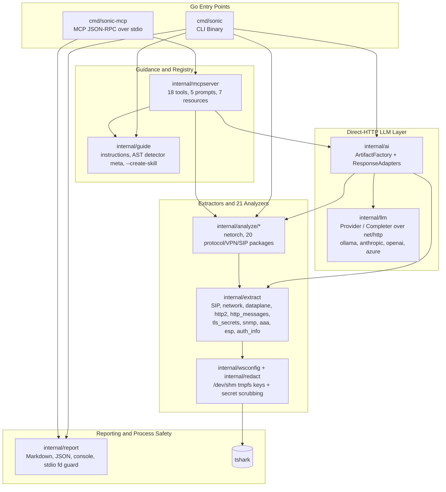
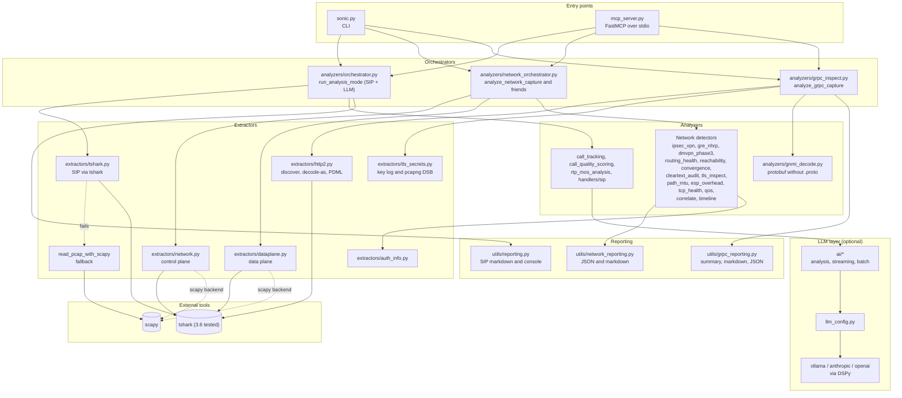
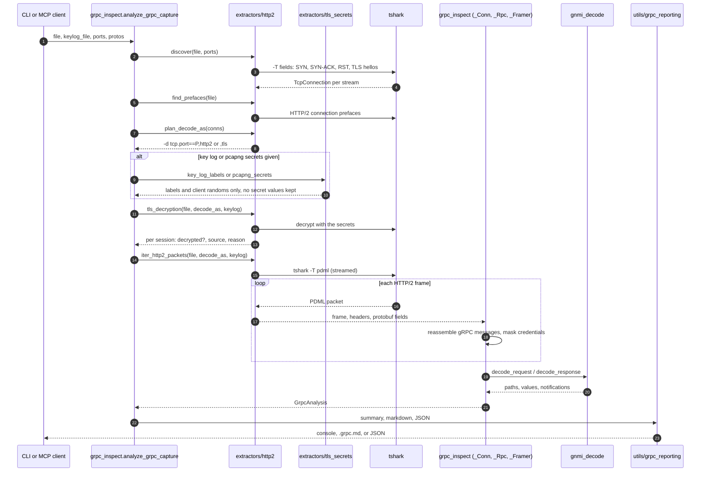
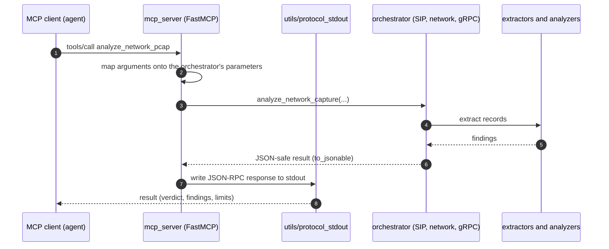
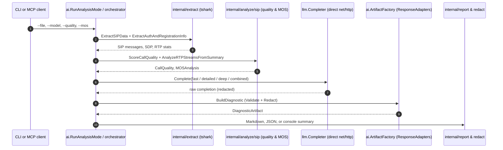
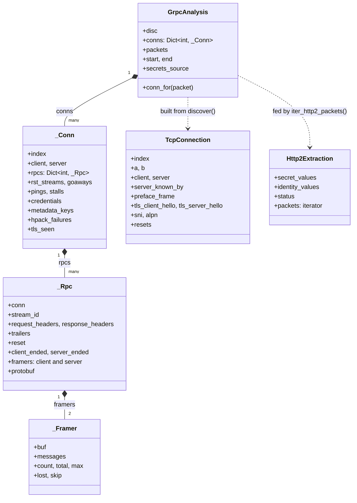
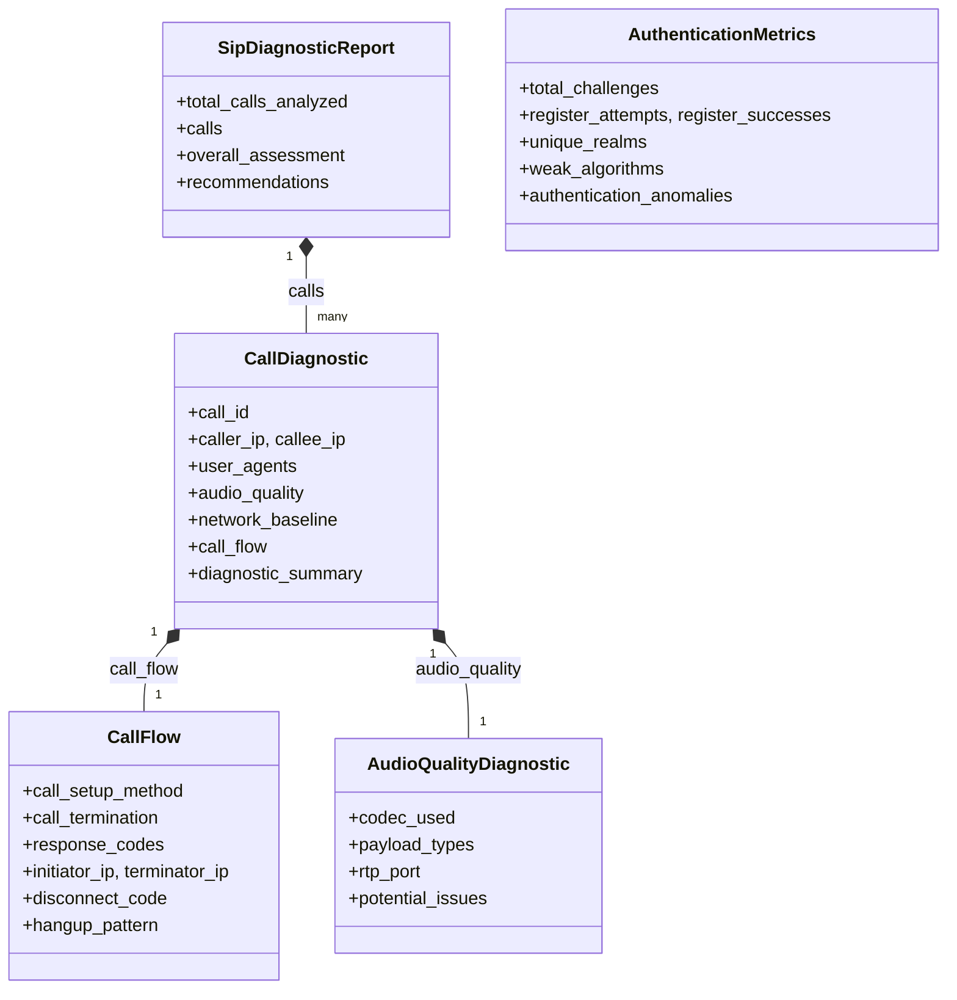
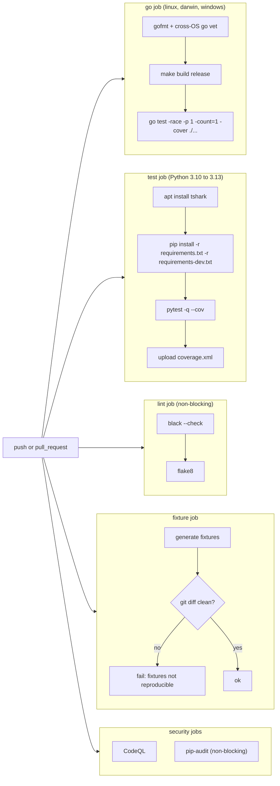

# S.O.N.I.C. Architecture

This page shows how S.O.N.I.C. is structured across both the **native Go binaries** (`cmd/sonic`, `cmd/sonic-mcp`) and the **Python reference implementation** (`sonic.py`, `mcp_server.py`), including the analysis paths, core abstractions, and CI pipeline. The diagrams are Mermaid, so GitHub renders them in place.

## 1. Component view

### Go Architecture (Native Static Binaries)

`cmd/sonic` and `cmd/sonic-mcp` are thin composition roots sharing identical extractors, 21 analyzer packages, direct-HTTP LLM clients, `ArtifactFactory`, guidance renderers, and secret redaction.

### Python Reference Components

Two entry points, the CLI (`sonic.py`) and the MCP server (`mcp_server.py`), call the same Python orchestrators. The orchestrators drive the extractors (`tshark` or `scapy`), analyzers, optional DSPy LLM layer, and reporting helpers.

The MCP server supplies a separate guide: instructions, prompts and `sonic://guide/*` resources, all built by `utils/agent_guide.py`. `utils/protocol_stdout.py` keeps stdout for JSON-RPC only.

## 2. Sequence: gRPC and TLS decryption

This is the most involved path. It runs with no LLM, and it needs tshark.

## 3. Sequence: MCP tool call

An agent calls a tool over stdio. The tool runs the same orchestrator code as the CLI, so both paths return the same results.

`protocol_stdout` exists so that a stray `print` cannot corrupt the protocol stream. Logs go to stderr.

## 4. Sequence: SIP analysis with an LLM

In Go (`internal/ai` + `internal/llm`), SIP and RTP extraction feed deterministic scoring alongside direct-HTTP SSE/NDJSON calls through `llm.Completer`, normalized and redacted via `ArtifactFactory` before Markdown/JSON output.

## 5. Class view

### gRPC analysis

The gRPC analyzer keeps per-connection state in three small classes, and the orchestrating class collects them.

Attributes are the ones that matter for reading the code, and `analyzers/grpc_inspect.py` (lines 220 to 420) and `extractors/http2.py` (lines 148 to 170, 400 to 415) are the reference.

### Pydantic schemas (SIP path)

`SipDiagnosticReport` holds the calls. `AuthenticationMetrics` stands alone and is built by the auth extractor, not nested in the report.

`AuthenticationMetrics` is not in the diagram's containment, because `SipDiagnosticReport` does not reference it.

## 6. CI pipeline

This is the workflow in `.github/workflows/ci.yml`. Both Go and Python suites run with `tshark` installed. The Python `lint` job reports without blocking while the Go `gofmt`, cross-OS `go vet`, release builds, and `-race` tests run as full gates.

