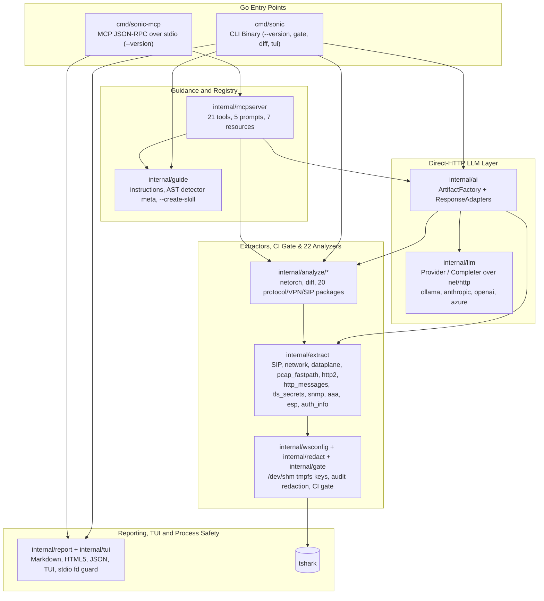
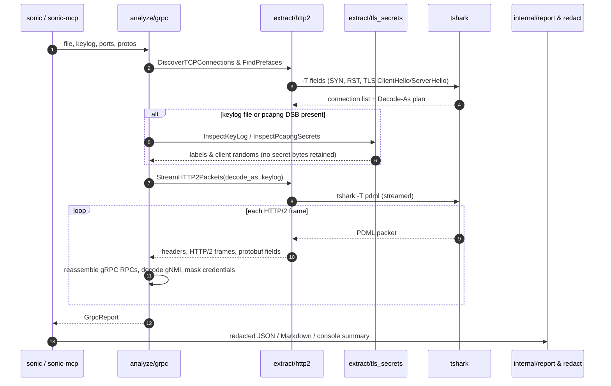
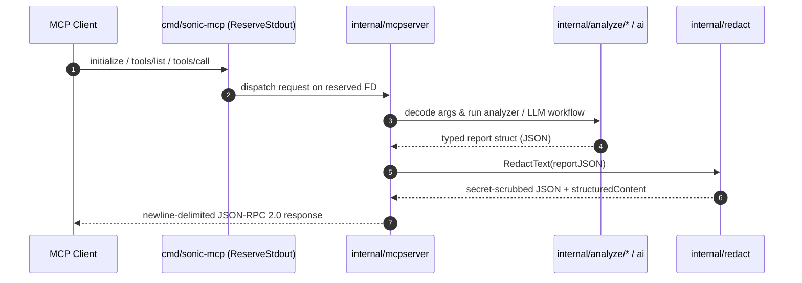
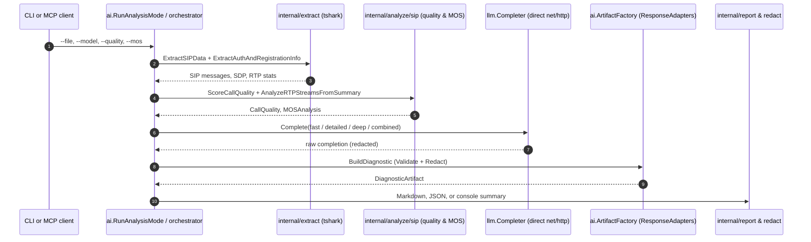
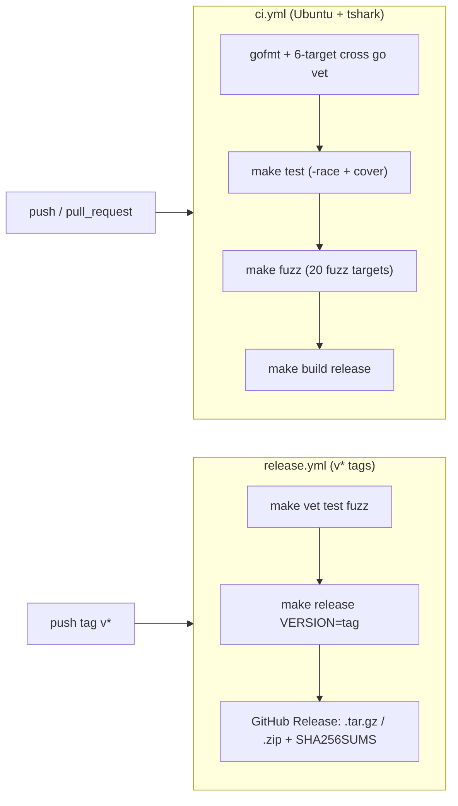

# S.O.N.I.C. Architecture

This page shows how the Go implementation of S.O.N.I.C. (`cmd/sonic`, `cmd/sonic-mcp`, and `internal/*`) is structured, including the analysis pipelines, gRPC/TLS decryption sequence, MCP server lifecycle, LLM `ArtifactFactory`, and CI/release workflows.

## 1. Component View (`cmd/*` & `internal/*`)

`cmd/sonic` and `cmd/sonic-mcp` are thin composition roots sharing extractors (`internal/extract`, including the pure-Go PCAP/PCAPNG `go-fast` reader), 22 analyzer packages (`internal/analyze/*`), CI policy gates (`internal/gate`), direct-HTTP LLM clients (`internal/llm`), `ArtifactFactory` (`internal/ai`), guidance renderers (`internal/guide`), secret redaction/audit (`internal/redact`, `internal/wsconfig`), offline HTML5 export (`internal/report`), and the interactive ANSI TUI (`internal/tui`).

## 2. Sequence: gRPC and TLS Decryption

Deterministic, no LLM, powered by Wireshark HTTP/2, HPACK, gRPC, TLS, and protobuf dissectors via `tshark`.

## 3. Sequence: MCP Tool Call & Stdio Isolation

Before entering the JSON-RPC loop, `cmd/sonic-mcp` duplicates descriptor `1` for protocol output and redirects OS `stdout` to `stderr` (`internal/report` `ReserveStdoutForProtocol`) so diagnostic progress never corrupts JSON-RPC framing.

## 4. Sequence: SIP Analysis with an LLM

In Go (`internal/ai` + `internal/llm`), SIP and RTP extraction feed deterministic scoring alongside direct-HTTP SSE/NDJSON calls through `llm.Completer`, normalized and redacted via `ArtifactFactory` before Markdown/JSON output.

## 5. Typed Packet & Report Model (`internal/model`)

Every dissector, analyzer, and reporter communicates through explicit domain structs rather than untyped dictionaries:
- **Normalized Frame Records (`Record`)**: typed pointers and presence flags (`*int`, `*bool`, `netip.Addr`, `TCPHeader`, `UDPHeader`, `IKEHeader`, `ESPHeader`, `NHRPPacket`, `BGPMessage`, `OSPFHeader`, `EIGRPHeader`) ensure zero values never mask absent `tshark` fields.
- **Deterministic Reports**: `DetectorReport`, `NetworkReport`, `AuditReport`, `GrpcReport`, `HTTPReport`, `SNMPReport`, `AAAReport`, `ESPReport`, `CorrelateReport`, `TimelineReport`, `DiffReport`, and `GateReport` serialize directly to stable JSON schemas (`testdata/golden/` for parity fixtures).
- **AI Artifacts**: `ReportOutput`, `CallDiagnostic`, `AudioQualityDiagnostic`, `CallFlow`, and `PartialStreamingResult` enforce schema invariants inside `ArtifactFactory`.

## 6. CI & Release Pipelines

`.github/workflows/ci.yml` and `.github/workflows/release.yml` enforce Go quality checks and cross-compile signed archives on every change and version tag:

